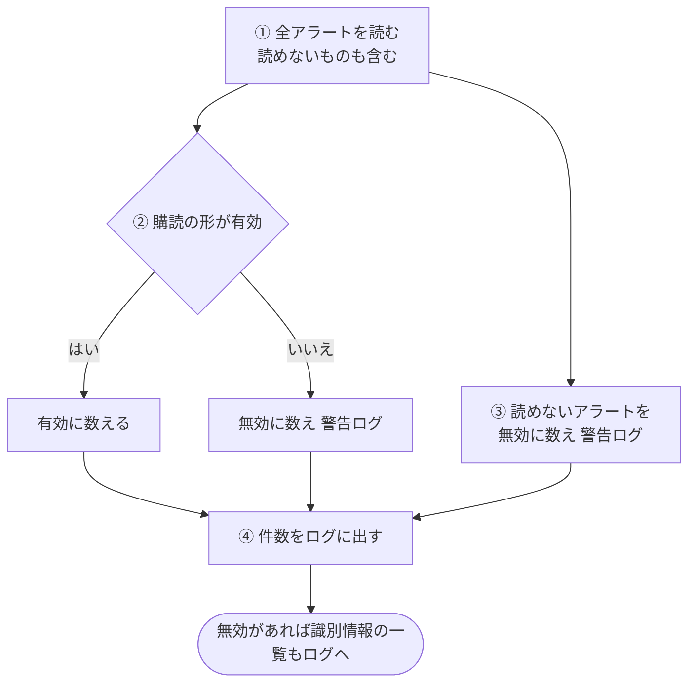
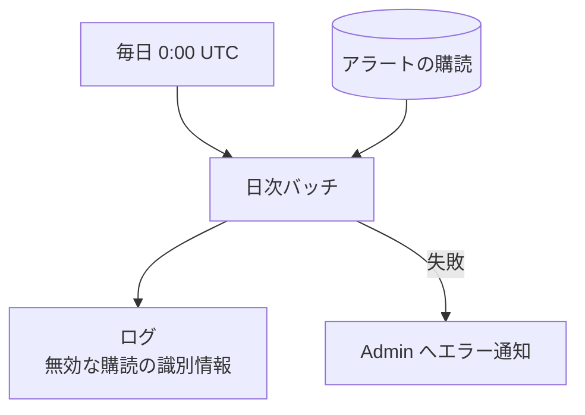

# 日次バッチ (daily)

全アラートの [Web Push の購読](../term/push-subscription.md)の形を点検し、無効なものをログに残すバッチ。何も書き換えず、何も消さない。

## 起点

- 毎日 0:00 UTC (日本時間 9:00。EventBridge: `cron(0 0 * * ? *)`)
- 全アラート (有効・無効、頻度、一時通知を問わない)
- Lambda はメモリ 512 MB、タイムアウト 10 分

## 処理

| 段 | 内容 |
|---|---|
| ① | 頻度ごとに全ページを読む。保存データが壊れていて読めないアラートは、捨てずに別に集める |
| ② | 有効の条件は、`endpoint` が空でなく URL として解釈できること、`keys.p256dh` と `keys.auth` が空でない (空白だけでない) こと。送信先のサービスには問い合わせない |
| ③ | 読めないアラートは、購読を確かめる以前に壊れているので、無効に数える |
| ④ | 全件数、有効、無効の件数を情報ログに出す。無効があれば、手動で削除するための識別情報 (アラート ID、利用者 ID。読めないものは保存キーも) を一覧にして出す |

- 無効な購読の警告ログには、アラート ID、利用者 ID、ティッカー ID、`endpoint` (空なら `(empty)`) を出す。読めないアラートには保存キーと理由を出す
- 自動では削除しない。送信時に 404、410 になる無効な購読は、この点検の対象ではない ([アラート通知の経路](../flow/alert-notification.md))

## 失敗したとき

- 無効な購読が見つかっても、失敗にはしない。Admin にも報告しない (ログのみ)
- アラートの読み込みの失敗など、すべての例外は、共通の骨格が「日次バッチ: 致命的エラー」を `error` で報告し、例外を再送出して Lambda を失敗にする
- CloudWatch Alarm も Admin に届く。5 分間の Errors の平均が 10% を超える、実行時間の平均が 8 分を超える、スロットリングが 1 回以上起きる、のいずれか
- Admin への経路は[エラー通知の経路](../../admin/flow/error-notification.md)

## つながり

