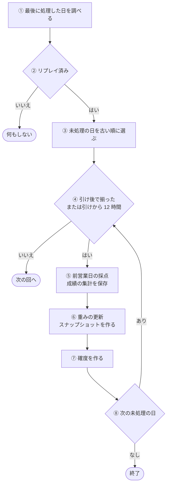
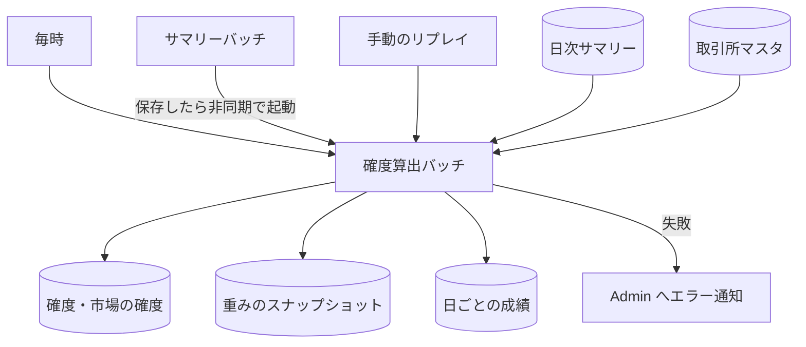

# 確度算出バッチ (forecast)

[日次サマリー](../term/daily-summary.md)から、市場ごとに「前営業日の採点 → 重みの更新 → 当日の[確度](../term/forecast.md)の算出」の 3 段を進めて保存するバッチ。

## 起点

- 1 時間ごと (EventBridge: `rate(1 hour)`)
- [サマリーバッチ](./summary.md)が日次サマリーを 1 件以上保存した回の終わり (Lambda の非同期呼び出し)
- 手動のリプレイ: イベントに `mode: 'replay'` を渡して起動する。稼働開始時の初期値算出用 (下の「リプレイ」)
- Lambda はメモリ 1024 MB、タイムアウト 15 分、同時実行 1
- 市場は取引所マスタの市場属性で決まる。市場が未設定の取引所は除く (ログに残す)

## 対象から外れる条件

通常モードで、市場ごとに次のどれかに当たると何もしない。

| 条件 | 外れる範囲 |
|---|---|
| リプレイが 1 回も済んでいない (方向の重みのスナップショットが 1 件もない) | その市場の全部 |
| 日次サマリーが 1 件もない | その市場の全部 |
| 最後に処理した日より後の日がない (処理した日に市場の確度もある) | その市場の全部 |
| 日付 D の名目引け時刻より前 | D 以降。次の回に回る |
| D の銘柄のサマリーが揃っておらず、名目引け時刻から 12 時間たっていない | D 以降。次の回まで待つ |

- 名目引け時刻は、取引所のタイムゾーンと終了時刻から決める。市場の名目引け時刻は、その市場の取引所のうち最も遅いもの
- 揃った: D の前の観測日 (市場のどこかの銘柄にサマリーがある、前の日付) にサマリーがあった銘柄が、すべて D にもサマリーを持つこと。D が市場の最初の観測日なら揃ったとみなす
- 12 時間たっても揃わないときは、揃っている銘柄だけで算出する。欠けた銘柄は、その日の確度なしで確定し、後からサマリーが届いても作り直さない

## 処理

通常モードで、市場ごとに次の流れで進む。

| 段 | 内容 |
|---|---|
| ① | 方向 (`DIR`) の最新のスナップショットの日付が、最後に処理した日 |
| ③ | 最後に処理した日の 60 日前から明日までのサマリーを読む。最後に処理した日自身も、その日の市場の確度がなければ未処理に含める |
| ⑤ | 前営業日 (市場の前の観測日) の銘柄の確度と市場の確度に、翌営業日の答え合わせを追記する。銘柄は 10 件まで並行して書く。前営業日の確度がない銘柄 (打ち切りで欠けたもの) は飛ばす。そのあと、3 つの[問い](../term/question.md)ごとに前営業日の成績を集計して保存する。D が市場の最初の観測日なら、この段はない |
| ⑥ | 3 つの問いごとに、保存済みの全サンプルから D のスナップショット (重み・基準値・中立帯) を作る。作成済みなら作り直さない。中立帯は、市場をまたいで、判定時刻が新しい前回のものを引き継ぐ |
| ⑦ | 銘柄ごとの確度 (軸の値、確率) と、市場の確度を作る。作成済みなら書かない。確率は、そのスナップショットの学習に使えた日が 30 日以上のときだけ出す。荒れは、平常を求められない銘柄には出さない。軸の値は確率がなくても記録する |

- 各段の書き込みは、作成済みなら書かない、追記済みなら追記しない条件付きで、同じ日を再度処理しても結果は変わらない。途中で落ちても、次の実行で続きから進める
- 確度には、算出したモデルの版 (`forecast-core-v1`) と、通常モードなら `LIVE` を記録する
- 環境変数で境界日が渡されているとき、通常モードでも、その日より前のサマリーから休場日のコピー足と途中足を除く (デプロイでは、設定があるときだけ渡す)

### リプレイ

稼働開始時や、過去の成績を作り直したいときに、手動で起動する。

- イベント: `legacyExclusionBefore` (必須)、`from`、`to`、`forceNeutralBandOn`
- 全期間のサマリーを 1 回読み、`legacyExclusionBefore` より前の足から休場日のコピー足と途中足を除く
- (市場, 日付) を名目引け時刻の順に 1 日ずつ、通常モードと同じ 3 段で処理する。確度には `REPLAY` を記録する。市場の確度が作成済みの (市場, 日付) は飛ばす
- サンプルは最初に 1 回読み、メモリ上に積み上げる
- 対象期間の最後のステップだけ、通常モードと同じ揃った判定と 12 時間の打ち切りを使う。揃っていなければ、そこで処理を終える
- 中立帯を見直し間隔によらず判定し直す日は、`forceNeutralBandOn`。省略すると、`to` がないときだけ最終日になる
- 15 分に収まらないときは、`from` と `to` で分けて実行する

## 上限

| 上限 | 値 |
|---|---|
| 1 回の実行で処理する日数 (通常モード) | 市場ごとに 10 日。残りは次の回に回す |

## 失敗したとき

- 通常モードの市場単位の失敗 (どの段の例外も) は、Admin に `error` で「確度算出バッチ: 市場処理失敗」を報告し (市場を添える)、他の市場は続ける。全市場を処理したあと、失敗した市場が 1 つでもあれば、例外を投げて Lambda を失敗にする。このとき共通の骨格が「確度算出バッチ: 部分失敗」を `error` で、失敗した市場と統計を添えて報告するので、同じ失敗が 2 件届く
- リプレイは、ステップが失敗した時点で止める。Admin に`確度算出バッチ（リプレイ）: ステップ処理失敗`を報告したあと、骨格が`確度算出バッチ（リプレイ）: 停止`を報告し、Lambda を失敗にする
- 取引所一覧の読み込みなど、これら以外の例外は、骨格が「確度算出バッチ: 致命的エラー」を `error` で報告し、例外を再送出して Lambda を失敗にする
- サマリーバッチからの起動に失敗しても、毎時の実行が拾う
- CloudWatch Alarm も Admin に届く。5 分間の Errors の平均が 10% を超えたとき。実行時間とスロットリングのアラームはない
- Admin への経路は[エラー通知の経路](../../admin/flow/error-notification.md)

## つながり

