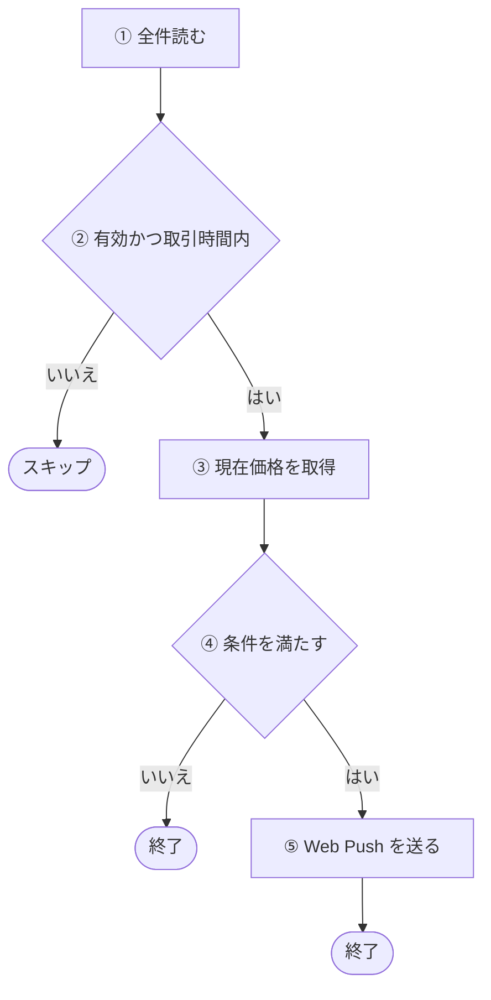
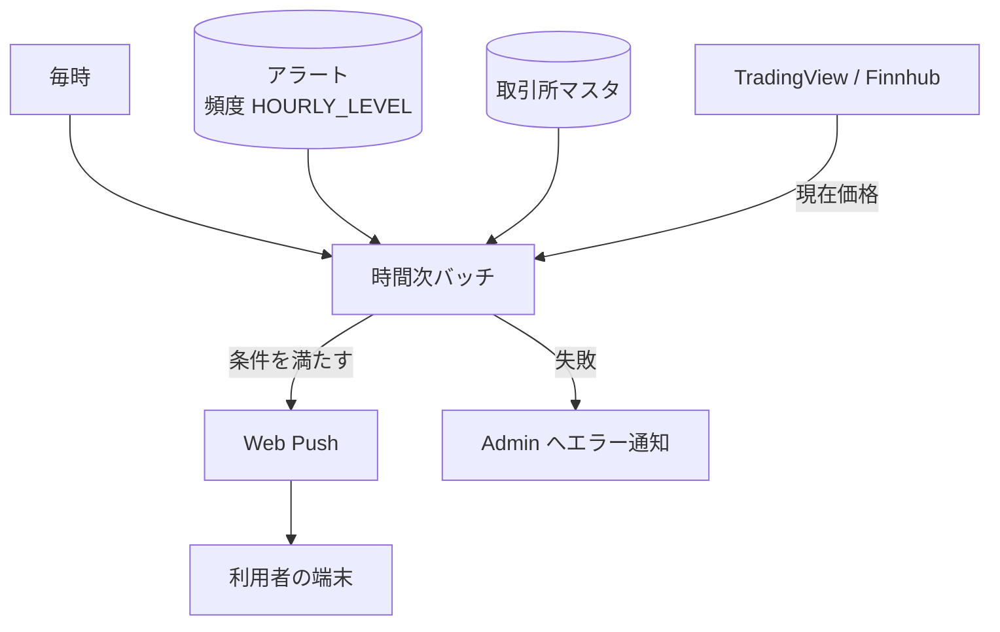

# 時間次バッチ (hourly)

頻度が 1 時間間隔 (`HOURLY_LEVEL`) のアラートの価格条件を毎時判定し、満たしたものへ Web Push を送るバッチ。[分次バッチ](./minute.md)と同じ判定を、1 件ずつ順に行う。判定から端末に届くまでの全体は[アラート通知の経路](../flow/alert-notification.md)にある。

## 起点

- 1 時間ごと (EventBridge: `rate(1 hour)`)
- 頻度が `HOURLY_LEVEL` のアラートを全件読む ([アラート API](../api/alerts.md))
- Lambda はメモリ 512 MB、タイムアウト 5 分

## 対象から外れる条件

| 条件 | 外れる範囲 |
|---|---|
| アラートが無効 | そのアラート |
| 取引所が[取引時間外](../term/trading-hours.md) | そのアラート |

- 読んだ時点で保存データが壊れているアラートは、警告ログを出して一覧から外す

## 処理

アラートごとに、全件を 1 件ずつ順に次の流れで処理する。

| 段 | 内容 |
|---|---|
| ② | 取引所は取引所マスタから引く。取引所が見つからないアラートは失敗に数える |
| ③ | 取得元は取引所の[価格の取得元](../term/price-source.md)で決まる。失敗したら最大 2 回取り直す (全部で 3 回。待ちは 0.5 秒、1 秒)。接続の共有はしない |
| ④ | 条件が 1 件なら、`gte` は価格が値以上、`lte` は値以下。2 件なら、`AND` は両方、`OR` はどちらかを満たすこと (`logicalOperator` がなければ `AND`) |
| ⑤ | 送り先はアラートが持つ[購読](../term/push-subscription.md)。通知の中身は[アラート通知の経路](../flow/alert-notification.md)にある |

- 送った結果が「購読が無効」(404、410) のときは、警告ログを残して成功扱いにする。失敗には数えず、アラートも購読も消さない
- 通知したあとも、アラートは有効のまま変わらない。条件を満たしている間は、取引時間内の毎回の実行で送る
- 時間予算や処理の打ち切りはない。5 分のタイムアウトに達すると、そこで実行が終わる

## 失敗したとき

- アラート単位の失敗は、そのアラートだけを失敗に数えて次へ進む。取引所が見つからないときは警告ログだけを残す。それ以外 (価格の取得失敗、条件の評価や通知本文の作成の例外、購読が無効以外の送信失敗) は、Admin にも `warning` で「時間次バッチ: アラート処理エラー」を報告する (アラート ID と利用者 ID を添える)。再送出しないので、全件が失敗しても Lambda は成功で終わる
- アラート一覧の読み込みなど、アラート単位でない例外は、共通の骨格が「時間次バッチ: 致命的エラー」を `error` で報告し、例外を再送出して Lambda を失敗にする
- CloudWatch Alarm も Admin に届く。5 分間の Errors の平均が 10% を超える、実行時間の平均が 4 分を超える、スロットリングが 1 回以上起きる、のいずれか
- Admin への経路は[エラー通知の経路](../../admin/flow/error-notification.md)

## つながり

