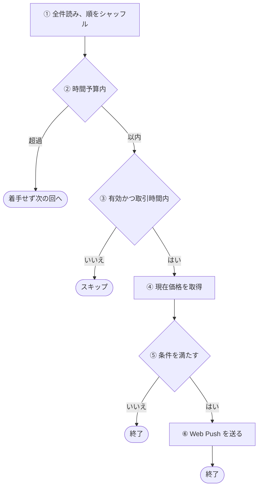
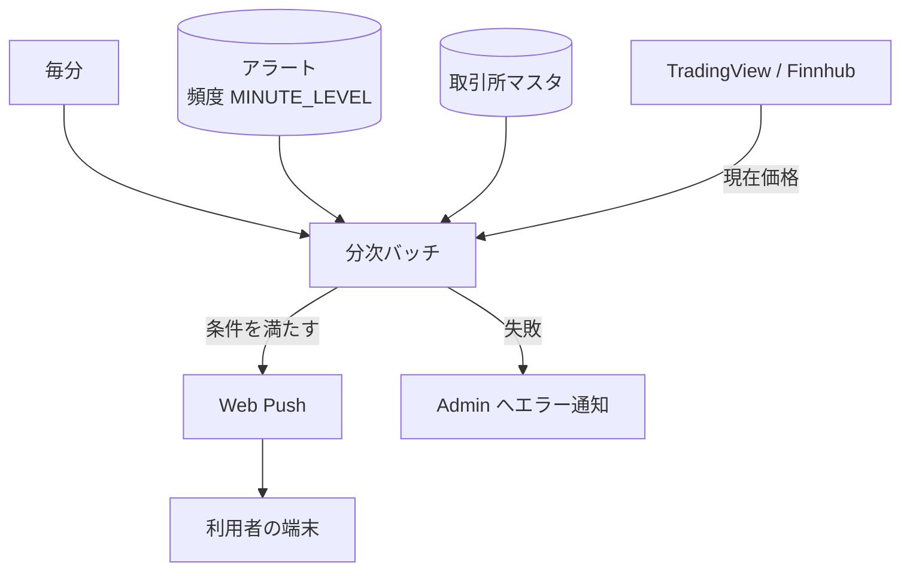

# 分次バッチ (minute)

頻度が 1 分間隔 (`MINUTE_LEVEL`) のアラートの価格条件を毎分判定し、満たしたものへ Web Push を送るバッチ。判定から端末に届くまでの全体は[アラート通知の経路](../flow/alert-notification.md)にある。

## 起点

- 毎分 (EventBridge: `rate(1 minute)`)
- 頻度が `MINUTE_LEVEL` のアラートを全件読む ([アラート API](../api/alerts.md))
- Lambda はメモリ 1024 MB、タイムアウト 50 秒、同時実行 1

## 対象から外れる条件

| 条件 | 外れる範囲 |
|---|---|
| アラートが無効 | そのアラート |
| 取引所が[取引時間外](../term/trading-hours.md) | そのアラート |
| 時間予算 (開始から 30 秒) を過ぎてから着手する順番になった | そのアラート。次の回に回る |

- 読んだ時点で保存データが壊れているアラートは、警告ログを出して一覧から外す

## 処理

アラートごとに次の流れで進む。

| 段 | 内容 |
|---|---|
| ① | 毎回ランダムな順に並べ替える。同時に 3 件まで処理し、着手のたびに 0〜150 ミリ秒未満のランダムな待ちを入れる |
| ② | 着手の直前に判定する。着手済みの処理は打ち切らない。1 件の最悪は 12.5 秒 (4 秒 + 0.5 秒 + 8 秒) |
| ③ | 取引所は取引所マスタから引く。取引所が見つからないアラートは失敗に数える |
| ④ | 取得元は取引所の[価格の取得元](../term/price-source.md)で決まる。`finnhub` は 1 回だけ呼び、タイムアウトは 4 秒。`tradingview` は実行ごとに 1 本の接続を全アラートで共有して 1 回目を取り (タイムアウト 4 秒)、失敗したら 0.5 秒待って新しい接続で 1 回だけ取り直す (タイムアウト 8 秒) |
| ⑤ | 条件が 1 件なら、`gte` は価格が値以上、`lte` は値以下。2 件なら、`AND` は両方、`OR` はどちらかを満たすこと (`logicalOperator` がなければ `AND`) |
| ⑥ | 送り先はアラートが持つ[購読](../term/push-subscription.md)。通知の中身は[アラート通知の経路](../flow/alert-notification.md)にある |

- 送った結果が「購読が無効」(404、410) のときは、警告ログを残して成功扱いにする。失敗には数えず、アラートも購読も消さない
- 通知したあとも、アラートは有効のまま変わらない。条件を満たしている間は、取引時間内の毎回の実行で送る
- 並列数・時間予算・各タイムアウト・待ちは環境変数で変えられる。デプロイでは、上の値と同じ値を設定している

## 上限

| 上限 | 値 |
|---|---|
| 1 回の実行で着手できる時間 | 開始から 30 秒 |

## 失敗したとき

- アラート単位の失敗は、そのアラートだけを失敗に数えて次へ進む。取引所が見つからないときは警告ログだけを残す。それ以外 (価格の取得失敗、条件の評価や通知本文の作成の例外、購読が無効以外の送信失敗) は、Admin にも `warning` で「分次バッチ: アラート処理エラー」を報告する (アラート ID と利用者 ID を添える)
- 失敗が 1 件以上あった回は、全アラートを処理して接続を閉じたあと、プロセスを終了コード 1 で終了する。Lambda の実行環境が捨てられ、次の回は新しい環境で始まる。この呼び出しは Lambda の失敗になる (件数の閾値は環境変数で変えられ、デプロイでは 1 を設定している)
- アラート一覧の読み込みなど、アラート単位でない例外は、共通の骨格が「分次バッチ: 致命的エラー」を `error` で報告し、例外を再送出して Lambda を失敗にする
- CloudWatch Alarm も Admin に届く。5 分間の Errors の平均が 10% を超える、実行時間の平均が 40 秒を超える、スロットリングが 1 回以上起きる、のいずれか
- Admin への経路は[エラー通知の経路](../../admin/flow/error-notification.md)

## つながり

