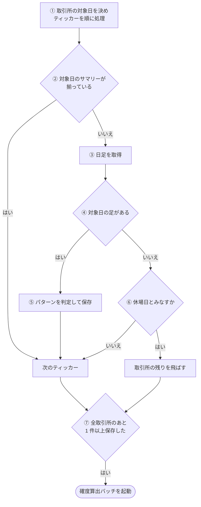
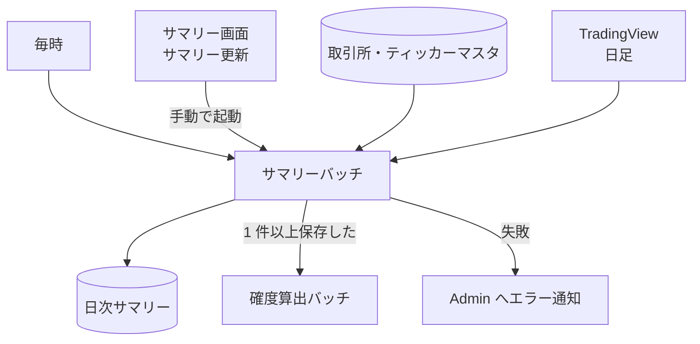

# サマリーバッチ (summary)

取引所ごとに、直近の取引日の日足を TradingView から取り、パターン判定とあわせて[日次サマリー](../term/daily-summary.md)として保存するバッチ。保存できたら、[確度算出バッチ](./forecast.md)を非同期で起動する。

## 起点

- 1 時間ごと (EventBridge: `rate(1 hour)`)
- 手動: サマリー画面の「サマリー更新」が、[サマリー API](../api/summaries.md) からこの Lambda を非同期で起動する
- Lambda はメモリ 512 MB、タイムアウト 5 分
- 全取引所を順に処理する。対象日は取引所ごとに決まる ([最新取引日](../term/trading-hours.md))

## 対象から外れる条件

| 条件 | 外れる範囲 |
|---|---|
| 対象日のサマリーがすでに揃っている (足の 4 本値と、全パターンの判定がある) | そのティッカー。日足は取らない |
| 日足が 0 件 | そのティッカー。警告ログを出す |
| 対象日の足がない (休場日、または対象日の分がまだ反映されていない) | そのティッカー。サマリーは作らない |
| 休場日とみなす条件に当たった | その取引所の残りのティッカー。この回だけ |

- 休場日とみなす条件: 対象日の足がなく、かつ最新の足が対象日から 7 日以内にあるティッカーが 3 件に達する。ただし、先に対象日の足があるティッカーが 1 件でも見つかっていれば判定しない。足が 7 日より前で止まっているティッカー (上場廃止など) は数えない

## 処理

取引所ごとに、ティッカーを 1 件ずつ順に進める。

| 段 | 内容 |
|---|---|
| ② | 既存のサマリーがない、4 本値のどれかがない、パターン判定がない、判定が足りないパターンがある、のどれかなら揃っていない |
| ③ | 日足 (`D`) を拡張セッション込みで 105 本取る。取得元は取引所の設定によらず TradingView |
| ④ | 取得した足のうち、取引所のタイムゾーンで対象日以前のものだけを使う (翌営業日の進行中の足を除く)。その先頭が対象日なら「ある」 |
| ⑤ | 対象日の始値・高値・安値・終値・出来高と、対象日以前の新しい 100 本によるパターン判定 (買い・売りの成立数を含む) を、ティッカー × 対象日で保存する。100 本に満たないときは、全パターンを判定不能、成立数を 0 にする |
| ⑦ | 起動は Lambda の非同期呼び出し。起動に失敗しても警告ログだけで、この実行の結果には影響しない |

- 同じティッカー・対象日が保存済みでも、揃っていなければ上書きする。作成日時は初回のものを保つ
- 揃っていないティッカーがあるかぎり、毎時の実行で日足を取り直す

## 失敗したとき

- ティッカー単位の失敗 (日足の取得や保存の例外) は、警告ログに「前回結果を維持」と残して次へ進む。Admin には `warning` で「サマリーバッチ: ティッカー日足データ取得失敗」を報告する (取引所 ID とティッカー ID を添える)
- 取引所単位の失敗 (ティッカー一覧の取得など) は、Admin に `error` で「サマリーバッチ: 取引所サマリー処理失敗」を報告して、次の取引所へ進む
- 上記は失敗に数えるだけで、実行の最後に例外は投げない。Lambda は成功で終わる
- 取引所一覧の読み込みなど、これら以外の例外は、共通の骨格が「サマリーバッチ: 致命的エラー」を `error` で報告し、例外を再送出して Lambda を失敗にする
- 確度算出バッチの起動に失敗しても、サマリーの保存は有効のまま。次の毎時の実行が確度算出を拾う
- CloudWatch Alarm も Admin に届く。5 分間の Errors の平均が 10% を超えたとき
- Admin への経路は[エラー通知の経路](../../admin/flow/error-notification.md)

## つながり

