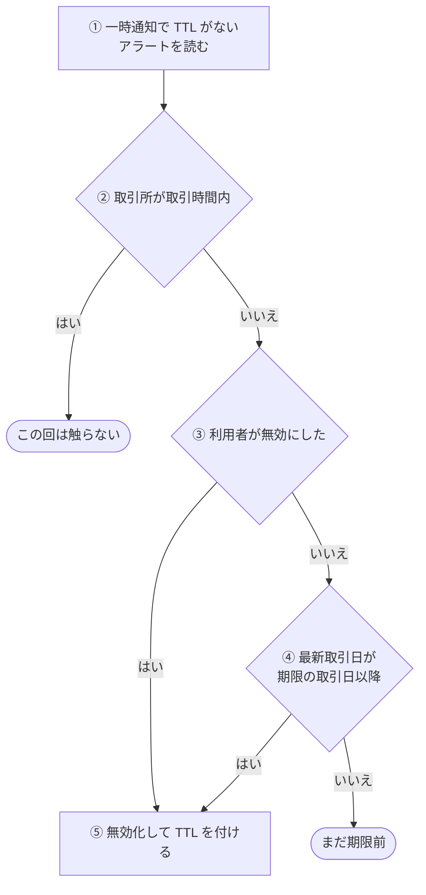
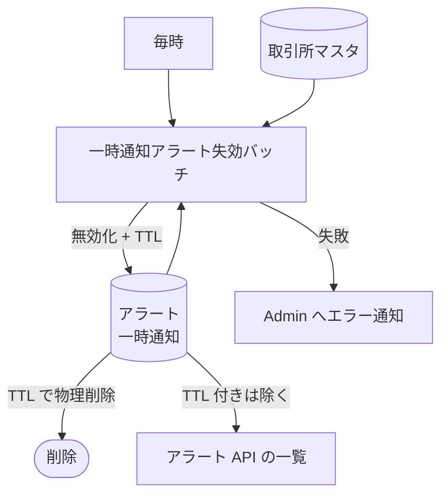

# 一時通知アラート失効バッチ (temporary-alert-expiry)

期限が過ぎた[一時通知](../term/temporary-alert.md)のアラートを無効にし、削除用の期限 (TTL) を付けるバッチ。物理的な削除は DynamoDB の TTL に任せる。

## 起点

- 1 時間ごと (EventBridge: `rate(1 hour)`)
- 一時通知のアラートのうち、TTL がまだ付いていないものを、頻度 (`MINUTE_LEVEL`、`HOURLY_LEVEL`) ごとに読む
- Lambda はメモリ 512 MB、タイムアウト 5 分

## 対象から外れる条件

| 条件 | 外れる範囲 |
|---|---|
| 一時通知でない (読み出しで絞っているが、念のため再確認する) | そのアラート |
| 期限の取引日がない | そのアラート |
| 取引所が[取引時間内](../term/trading-hours.md) | そのアラート。この回は何もしない |
| 最新取引日が、期限の取引日にまだ届いていない (利用者が無効にしたものを除く) | そのアラート |

- 取引所が見つからないアラートは、失敗に数える
- 読んだ時点で保存データが壊れている候補は、警告ログを出して一覧から外す

## 処理

候補を 1 件ずつ、次の流れで処理する。

| 段 | 内容 |
|---|---|
| ① | 読む項目は、判定に要るもの (アラート ID、利用者 ID、取引所 ID、頻度、有効、一時、期限の取引日) だけ。購読は読まない。1 ページ 50 件ずつ、頻度ごとに最大 20 ページまで |
| ④ | 日付は `YYYY-MM-DD` の文字列で比べる。最新取引日が期限の取引日と同じか、それより後なら失効 |
| ⑤ | 「無効にする」と「TTL を付ける」を 1 回の更新で行う。TTL は実行時刻の 7 日後 |

- 利用者が無効にした一時通知は、期限を待たず、取引時間外になった回に TTL を付ける
- TTL が付いたアラートは、次回から読む対象に入らず、一覧 API にも出ない

## 上限

| 上限 | 値 |
|---|---|
| 頻度ごとに読むページ数 | 20 ページ (1 ページ 50 件)。超えたら警告ログを出して、読めた分で処理する |

## 失敗したとき

- 候補単位の失敗 (取引所が見つからない、更新の失敗) は、失敗に数えてログに残し、次の候補へ進む。更新のあとに保存データの壊れが分かった場合も、更新は済んでいるので TTL は付く。Admin には報告せず、実行の最後に例外も投げない。Lambda は成功で終わる
- アラートの読み込みの失敗など、候補単位でない例外は、共通の骨格が「一時通知アラート失効バッチ: 致命的エラー」を `error` で報告し、例外を再送出して Lambda を失敗にする
- CloudWatch Alarm も Admin に届く。5 分間の Errors の平均が 10% を超えたとき
- Admin への経路は[エラー通知の経路](../../admin/flow/error-notification.md)

## つながり

