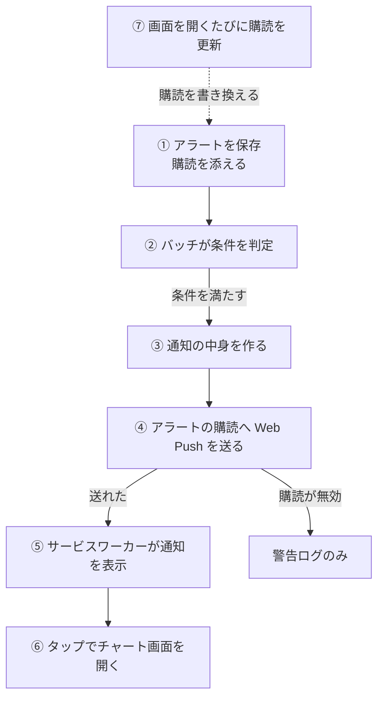

# アラート通知の経路

アラートの価格条件が満たされてから、利用者の端末に Web Push の通知が出て、タップでチャート画面が開くまでの流れ。

## 起点

- 利用者が作ったアラート。通知の宛先となる[購読](../term/push-subscription.md)を、アラートが 1 件ずつ持つ ([アラート API](../api/alerts.md))
- 条件を判定するバッチは、アラートの頻度で決まる

| 頻度 | バッチ | 実行 |
|---|---|---|
| `MINUTE_LEVEL` | [分次バッチ](../batch/minute.md) | 毎分。3 件ずつ並行して処理する |
| `HOURLY_LEVEL` | [時間次バッチ](../batch/hourly.md) | 毎時。1 件ずつ順に処理する |

## 経路

1. **保存**: 画面がアラートを作るとき、通知の許可を求めて購読を作り、アラートに添えて保存する
2. **判定**: バッチが、次の順にアラートを絞る
    - 有効で、取引所が[取引時間内](../term/trading-hours.md)であること。外れたアラートは何もしない
    - 取引所の[価格の取得元](../term/price-source.md)から現在価格を取る
    - 条件を評価する。1 件なら、`gte` は価格が値以上、`lte` は値以下。2 件なら、`AND` は両方、`OR` はどちらかを満たすこと
3. **通知の中身**: 下の「通知の中身」の内容を作る
4. **送信**: 判定したアラート自身の購読 1 件へ送る。VAPID の鍵は環境変数から読む
    - 送れた: 成功に数える
    - 送り先が 404 か 410 を返した (購読が無効): 警告ログだけを残す。失敗には数えず、アラートも購読も消さない
    - それ以外の失敗 (VAPID の鍵がないなど): そのアラートの失敗に数える ([エラー通知の経路](../../admin/flow/error-notification.md))
5. **表示**: 端末のサービスワーカーが通知を受け、ペイロードのタイトル、本文、アイコンで表示する。ペイロードに `tag` がないので `stock-alert` を付ける。操作するまで残る
6. **タップ**: 通知の URL を開く。同じサービスのウィンドウがすでに開いていればそこを移動して前面に出し、なければ新しいウィンドウを開く。URL がなければ `/alerts` を開く
7. **購読の更新**: 画面はどのページでも、開くたびにサービスワーカーを登録し、通知を許可済みなら購読を作り直して [Push 通知 API](../api/push.md) に送る。利用者のアラート (最大 100 件) のうち、購読が違うものがすべて新しい購読に書き換わる。別の端末で画面を開くと、宛先がその端末に変わる

- 通知したあともアラートは有効のままで、通知済みの記録もない。条件を満たしている間は、取引時間内の実行のたびに通知する (分次は毎分、時間次は毎時)
- 同じタグの通知は、新しいものが先に出ているものを置き換える (Notification API の仕様)
- 一時通知は、期限の取引日を過ぎると[失効バッチ](../batch/temporary-alert-expiry.md)が無効にし、以降は判定されない ([一時通知](../term/temporary-alert.md))

### 通知の中身

- タイトル: 「買いアラート: {ティッカー ID}」(モードが `Buy`) か「売りアラート: {ティッカー ID}」(`Sell`)
- 本文: 価格は小数 2 桁で書く。カスタムメッセージが前後の空白を除いて空でなければ、改行して末尾に足す

| 条件 | 本文 |
|---|---|
| 1 件 | `現在価格 $X が目標価格 $Y 以上になりました` (`lte` は「以下」) |
| 2 件、`AND` | `現在価格 $X が範囲 $下限〜$上限 内になりました` (下限は `gte` の値、上限は `lte` の値) |
| 2 件、`OR` | `現在価格 $X が範囲外（$lte の値 以下 または $gte の値 以上）になりました` |

- アイコン: `/icon-192x192.png`
- 付ける情報: アラート ID、取引所 ID、ティッカー ID、モード、現在価格、目標価格 (1 件はその値、2 件は `gte` の値)、開く先の URL (`/?exchangeId={取引所 ID}&tickerId={ティッカー ID}`)

## 届く先

- 購読に結びついた、利用者のブラウザ (端末)。アラート 1 件につき宛先は 1 つ
- タップすると、チャート画面 ([トップ画面](../screen/home.md)) が、通知の取引所とティッカーを選んだ状態で開く

## 失敗・取りこぼしのとき

- 購読が無効なら通知は届かないが、バッチは成功で終わり、Admin にも報告しない。利用者が画面を開いて購読が更新されるまで、届かない回が続く
- [日次バッチ](../batch/daily.md)は、保存された購読の形 (URL と鍵の有無) を点検してログに出すだけで、送信先の生死は確かめない
- 分次バッチは、時間予算 (30 秒) を過ぎると、残りのアラートをその回は判定しない。判定は次の回で行う
- 価格の取得に失敗したアラートは、その回は判定されない。失敗は Admin に `warning` で報告される
