# アラート一覧画面

自分のアラートの一覧と、絞り込み、編集、削除を行う。

## 入口

- パスは `/alerts`。ヘッダーの「アラート」と、トップ画面のクイックアクションから来る

## 表示の条件

- 一覧は `stocks:read` で見られる。編集と削除は `stocks:write-own` を持つときだけ出る ([権限とロール](../term/permission.md))

## 表示するもの

| 部分 | 内容 |
|---|---|
| 絞り込み | 取引所 (ティッカー ID の前半の取引所キーで判定)、モード (買い・売り)。「クリア」で外す |
| 一覧 | 列はモード、取引所、ティッカー、条件、頻度、状態、一時通知、操作 |

- 条件の書き方は、1 件なら「価格 以上 (>=) N」「価格 以下 (<=) N」、2 件で `AND` なら「価格 N1 ～ N2 (範囲内)」、`OR` なら「価格 N1 以下 または N2 以上 (範囲外)」
- 頻度は「1分間隔」か「1時間間隔」。状態は「有効」か「無効」。一時通知は「一時」か「常設」([一時通知](../term/temporary-alert.md))
- 取引所の名前は[取引所 API](../api/exchanges.md) から補い、取れなければキーのまま出す

## 状態

- 読み込み中は読み込み表示を出す
- 0 件のときは「アラートがありません」。絞り込みで 0 件のときは「フィルタ条件に一致するアラートがありません」
- 取得に失敗したときはエラーを出す

## 操作

| 操作 | 結果 |
|---|---|
| 編集する | アラート設定ダイアログを開く。成功すると「アラートを更新しました」を 3 秒出し、一覧を読み直す |
| 削除する | 確認のあとに[アラート API](../api/alerts.md) で削除し、一覧を読み直す |

アラート設定ダイアログ (トップ画面、サマリー画面の詳細、保有株式画面からも開く) の内容。

- 作成では、モード、条件 (単一か範囲)、入力方式 (手動入力か、基準価格からの割合。-20%〜+20% を 5% 刻み)、頻度、一時通知、カスタムメッセージを入力する。初めて作るときは通知の許可を求め、[Push 通知 API](../api/push.md) で購読を作ってから[アラート API](../api/alerts.md) に登録する
- 編集では、モードと頻度は表示のみ。条件、有効・無効、一時通知、カスタムメッセージを変えられる。カスタムメッセージを空にしても、送るのは中身があるときだけなので、既存のメッセージは消えない
- 価格は 0.01〜1,000,000、カスタムメッセージは 500 文字以内

## 画面の見た目

### 通常表示

買い・売り、範囲指定、無効、一時通知の例を並べる。

| スマホ | PC |
|---|---|
| 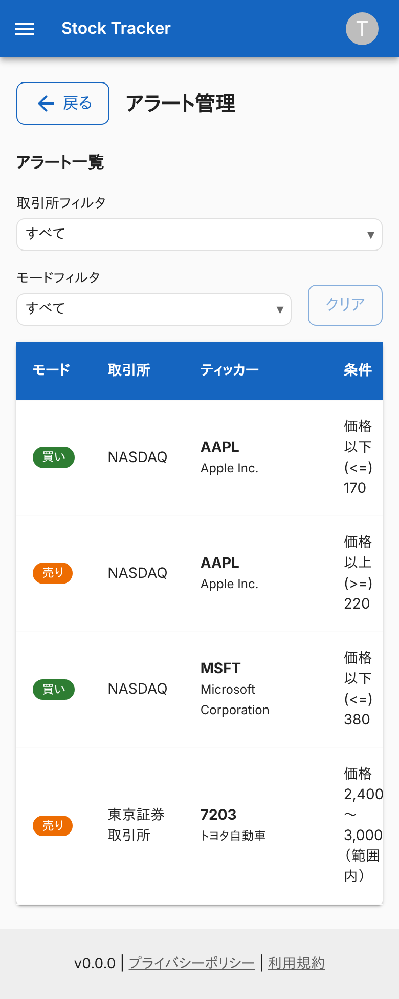 | 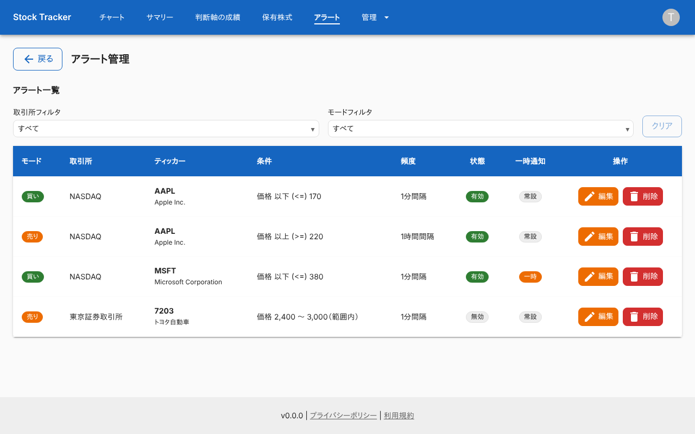 |

### 絞り込んだ状態

取引所とモードで絞る。

| スマホ | PC |
|---|---|
| 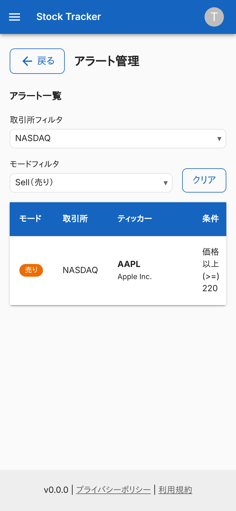 | 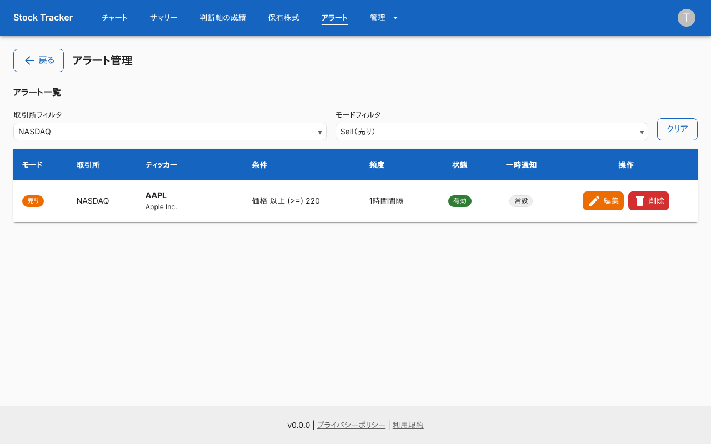 |

### 絞り込みで 0 件のとき

「フィルタ条件に一致するアラートがありません」を出す。

| スマホ | PC |
|---|---|
| 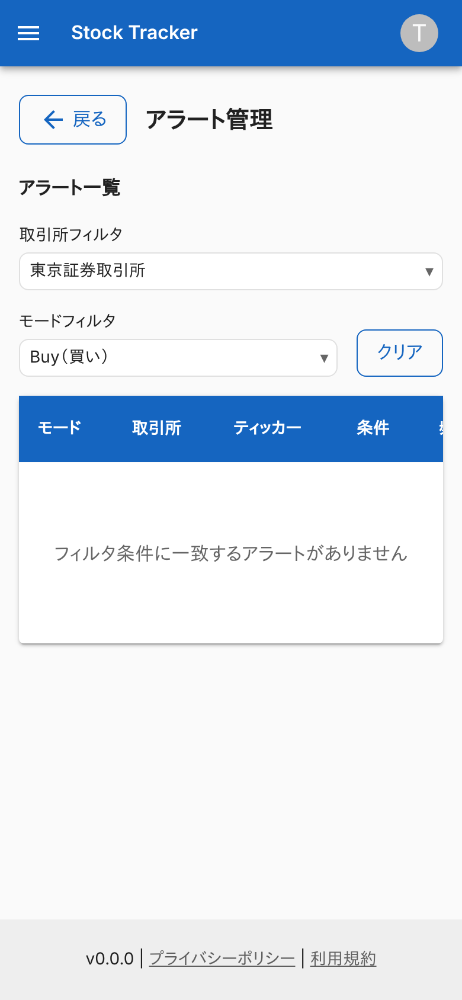 | 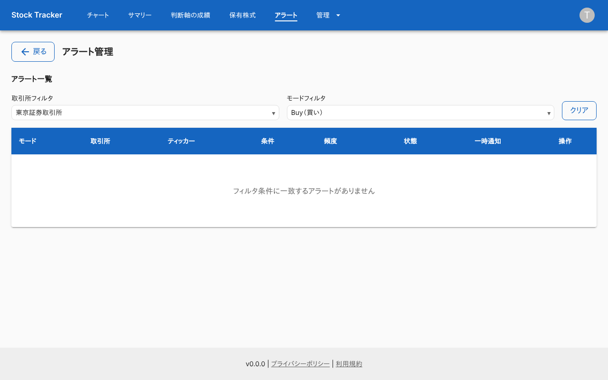 |

### アラートがないとき

「アラートがありません」を出す。

| スマホ | PC |
|---|---|
| 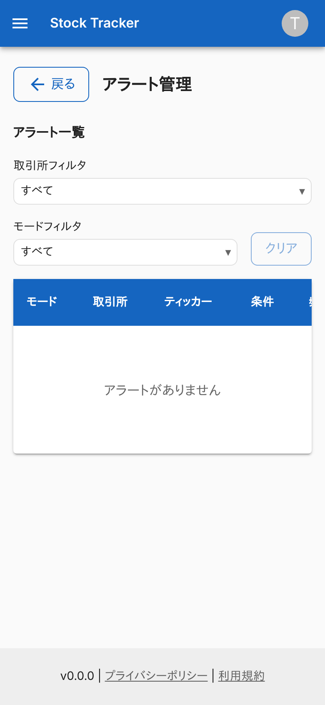 | 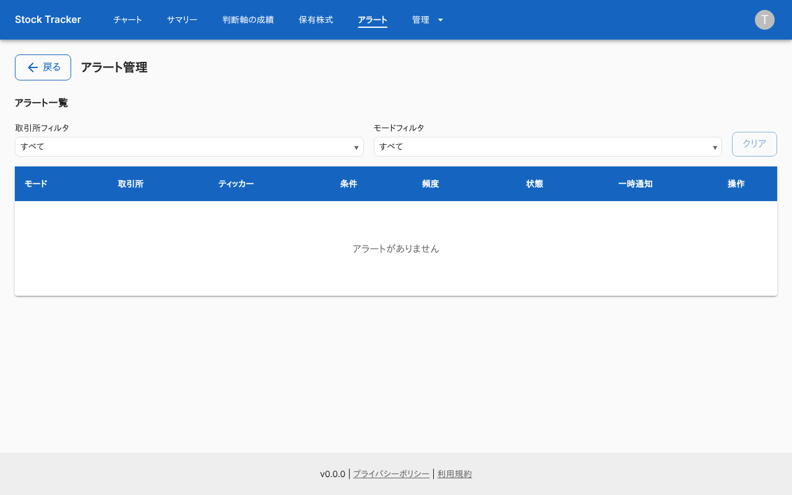 |

### 編集ダイアログ

縦に長いため、条件などの入力欄はダイアログの中をスクロールして入力する。

| スマホ | PC |
|---|---|
| 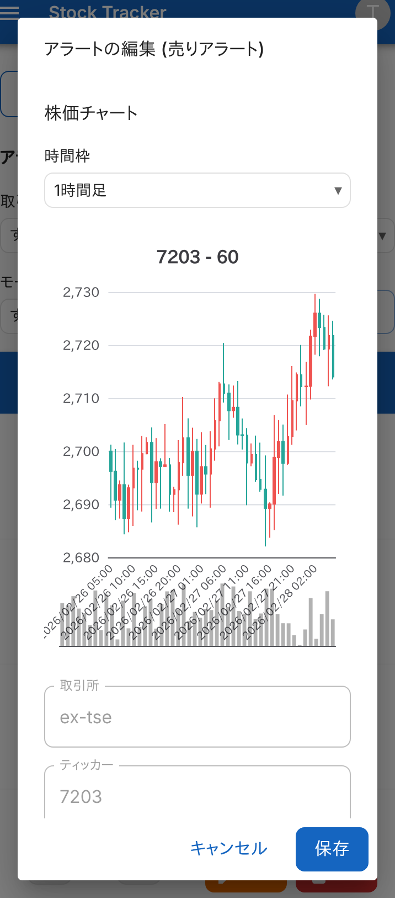 | 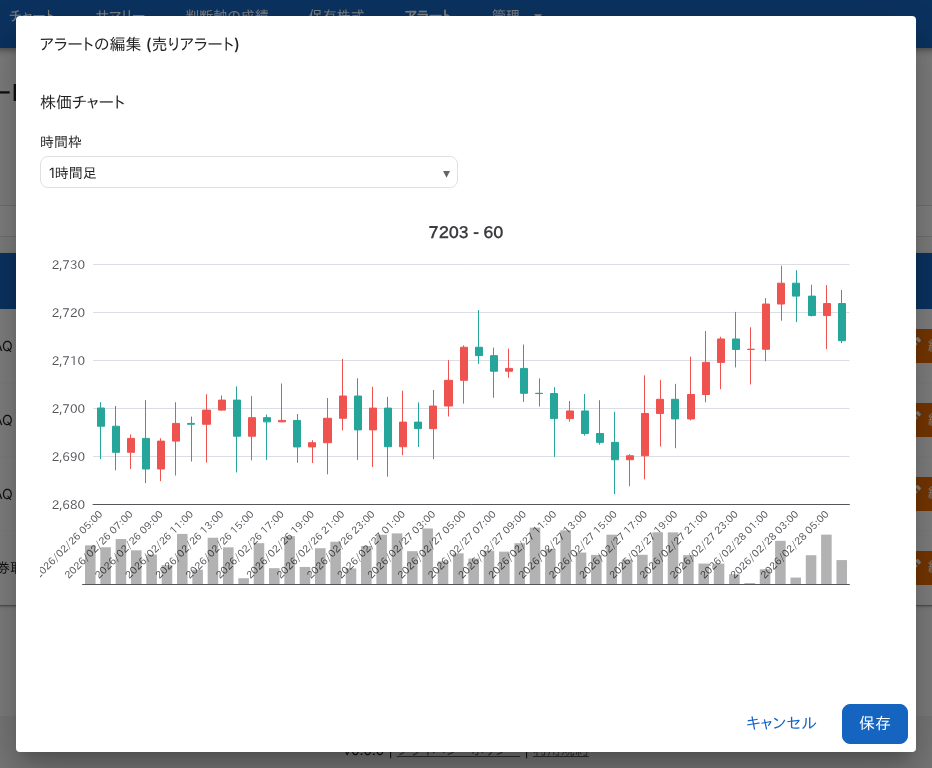 |

### 削除の確認

| スマホ | PC |
|---|---|
| 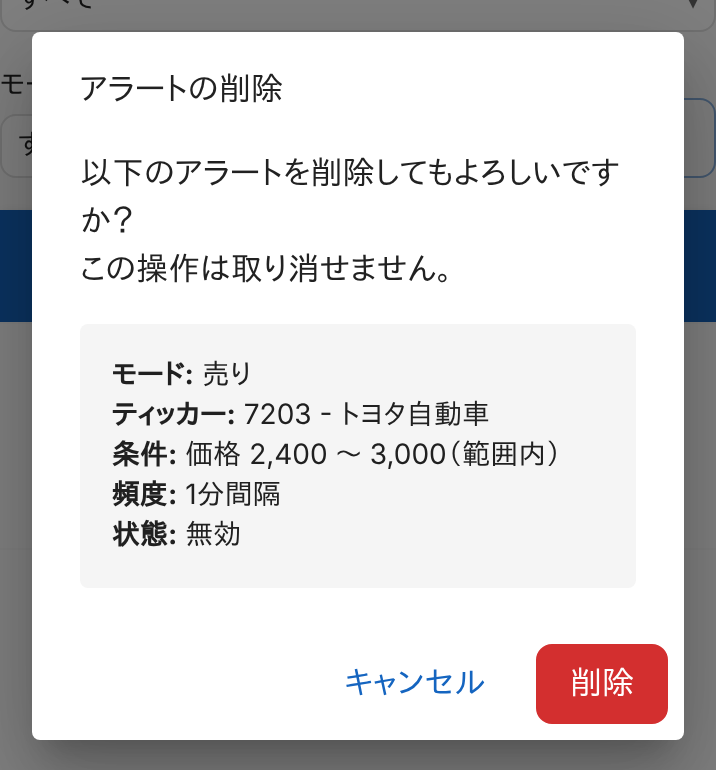 | 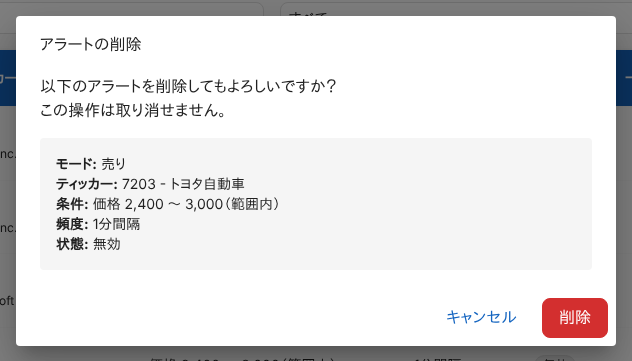 |

### 一覧の取得に失敗したとき

エラーを出す。

| スマホ | PC |
|---|---|
| 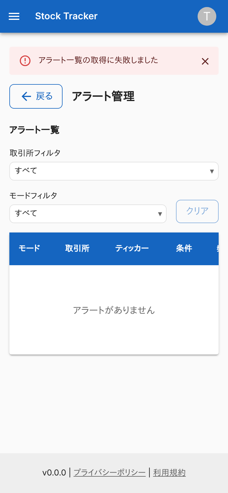 | 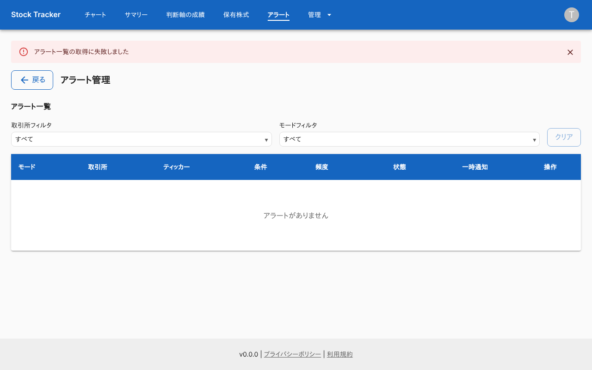 |

### 閲覧だけできるロール (`stock-viewer`)

操作の列が出ない。

| スマホ | PC |
|---|---|
|  |  |

## つながり

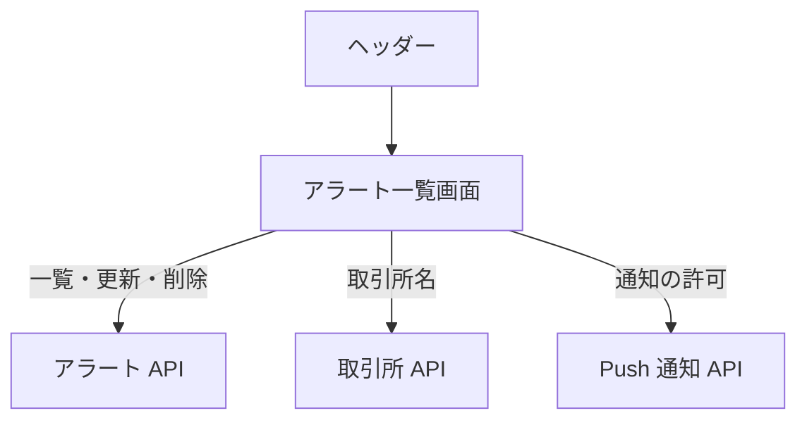
