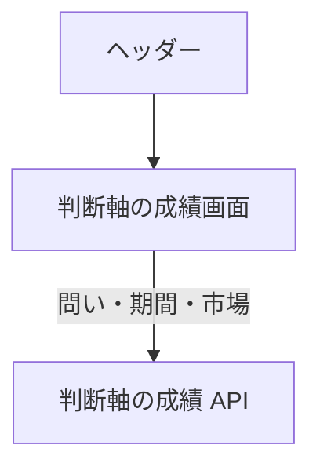

# 判断軸の成績画面

問い・期間・市場を切り替えて、[確度](../term/forecast.md)の当たり具合と、[判断軸](../term/axis.md)ごとの成績を見る。

## 入口

- パスは `/axis-performance`。ヘッダーの「判断軸の成績」から来る

## 表示の条件

- `stocks:read` を持つ利用者だけ。権限がなければ「判断軸の成績を表示する権限がありません。」を出す ([権限とロール](../term/permission.md))
- セッションの確認中は「セッション情報を確認中...」を出す

## 表示するもの

| 部分 | 内容 |
|---|---|
| 見出しの下 | 「採点済み N 件 ／ ふだん X%」と、集計した予測日の範囲。「？」で、ふだんの意味 (方向は市場平均を上回った割合、荒れ系は平常より荒れた割合) を見られる |
| 問い | 方向・荒れ・市場の荒れのタブ。初期値は方向 |
| 集計期間 | 30 日・90 日・全期間。初期値は 90 日 |
| 市場 | 全体・JP・US。初期値は全体。市場の荒れには「全体」がなく、切り替えたときに全体なら JP になる |
| 確度の成績 | 中立帯の説明、確率帯ごとの件数・予測の平均・実際の的中率の表、信頼度の図。件数が 30 件未満の帯は薄く出る |
| 軸ごとの成績 | 列は軸名、種類、件数、的中率、ふだんとの差、平均超過リターン (方向のみ)、現在の重み。件数不足の軸には「件数不足」が付く |

- 軸の表は、列の見出しで並べ替えられる。初期の並びは API の順。名前と種類は昇順、それ以外は降順から始まる

## 状態

- 読み込み中は「判断軸の成績を読み込み中...」
- 採点済みの予測が 0 件のときは「この期間に採点済みの予測はありません」
- 取得に失敗したときは、状態で文言が変わるエラーを出す (401 / 403 は権限、そのほかの 4xx は「リクエストパラメータが不正です。」、5xx は「サーバーエラーが発生しました。しばらく時間をおいて再度お試しください。」)

## 操作

| 操作 | 結果 |
|---|---|
| 問い・期間・市場を切り替える | 選んだ値で[判断軸の成績 API](../api/axis-performance.md) を読み直す |
| 軸の表の見出しを押す | その列で並べ替える。同じ列をもう一度押すと昇順と降順が入れ替わる |

## つながり

