# 取引所管理画面

取引所マスタの一覧と、作成、編集、削除を行う管理画面。

## 入口

- パスは `/exchanges`。ヘッダーの「管理」メニューの「取引所」から来る

## 表示の条件

- `stocks:manage-data` を持つ利用者だけ。権限がなければ、一覧を読まずに「権限エラー」を出す ([権限とロール](../term/permission.md))
- セッションの確認中は「セッション情報を確認中...」を出す

## 表示するもの

| 部分 | 内容 |
|---|---|
| 一覧 | 列は取引所 ID、取引所名、API キー、タイムゾーン、取引時間、データソース、市場、操作 |
| 作成・編集の入力 | 取引所 ID、取引所名、API キー、タイムゾーン、取引開始・終了 (時と分を別に選ぶ)、データソース、市場 |

- タイムゾーンの選択肢は `America/New_York` と `Asia/Tokyo`。データソースは TradingView と Finnhub。市場は日本と米国 (未設定にもできる)
- 作成するときの初期値は、データソースが TradingView、取引時間が 09:30〜16:00

## 状態

- 0 件のときは「取引所が登録されていません」
- 401 / 403 のときは、ログインが必要または権限がない旨のエラーを出す

## 操作

| 操作 | 結果 |
|---|---|
| 作成する | [取引所 API](../api/exchanges.md) に登録し、成功すると一覧を読み直す。市場が未設定なら送らない |
| 編集する | 取引所名、タイムゾーン、取引時間、データソース、市場を変えられる。取引所 ID と API キーは表示のみ。市場を未設定に戻すと、既存の市場の設定を消す |
| 削除する | 確認のあとに削除する。その取引所のティッカーなどは確認しない |

## 画面の見た目

### 通常表示

| スマホ | PC |
|---|---|
| 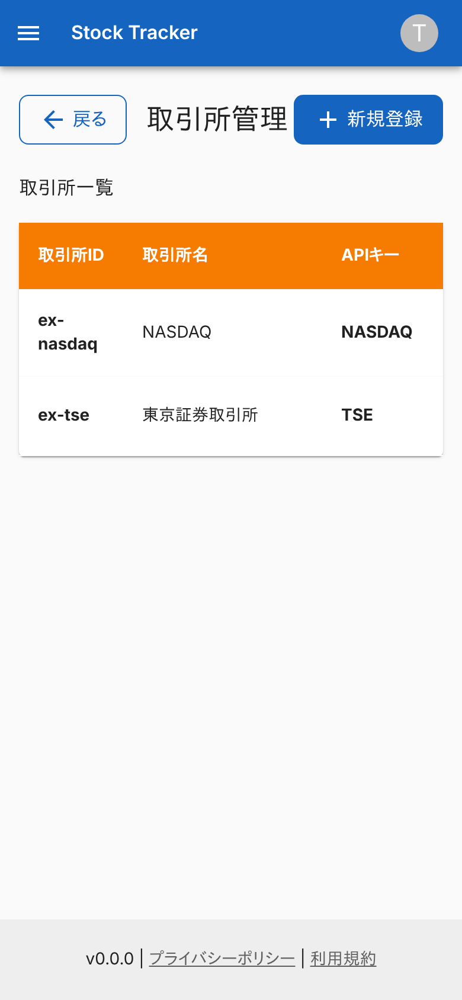 | 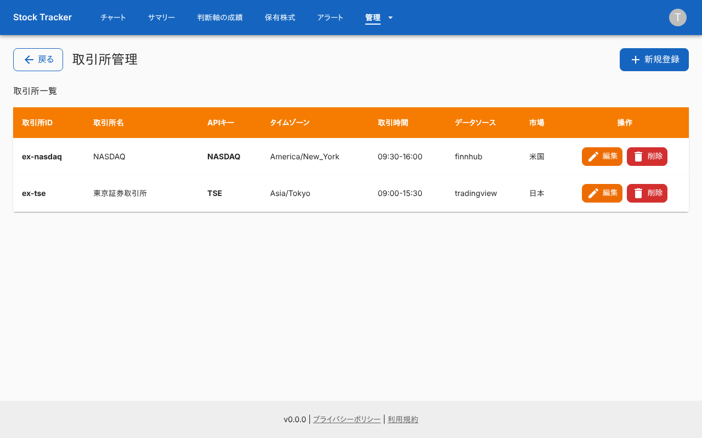 |

### 取引所がないとき

「取引所が登録されていません」を出す。

| スマホ | PC |
|---|---|
| 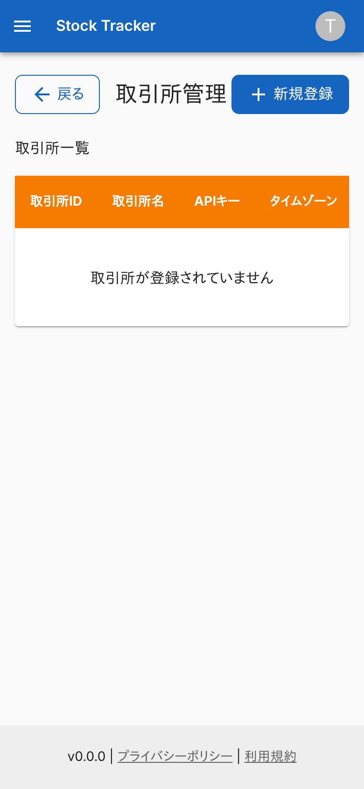 | 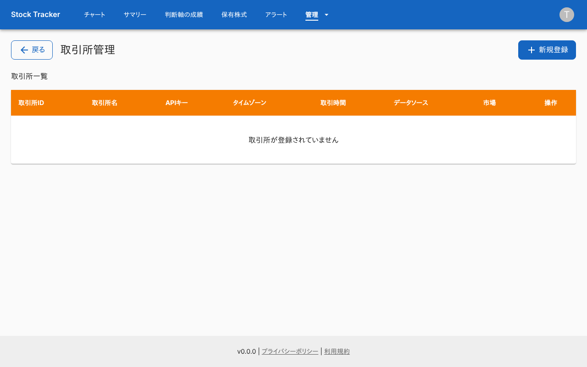 |

### 登録ダイアログ

縦に長いため、下の取引時間の欄はダイアログの中をスクロールして入力する。

| スマホ | PC |
|---|---|
| 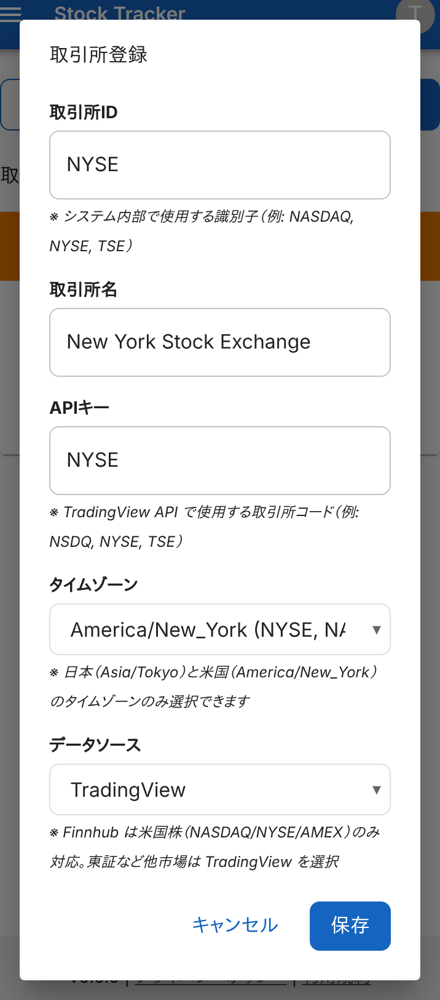 | 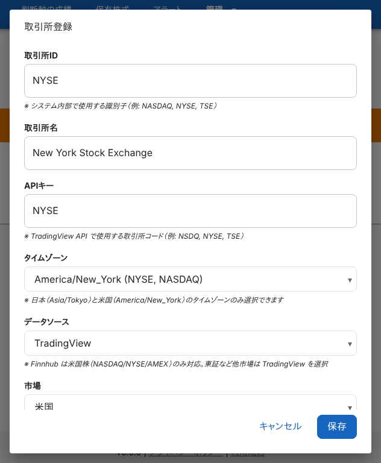 |

### 入力エラーのとき

必須のタイムゾーンを選ばずに保存した例。API が返したエラーを、ダイアログの裏の画面に出す。

| スマホ | PC |
|---|---|
| 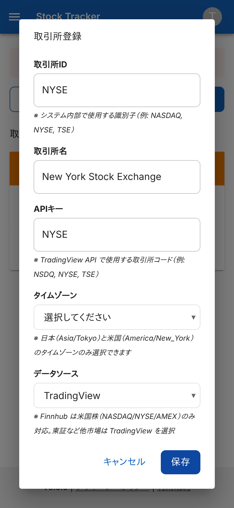 | 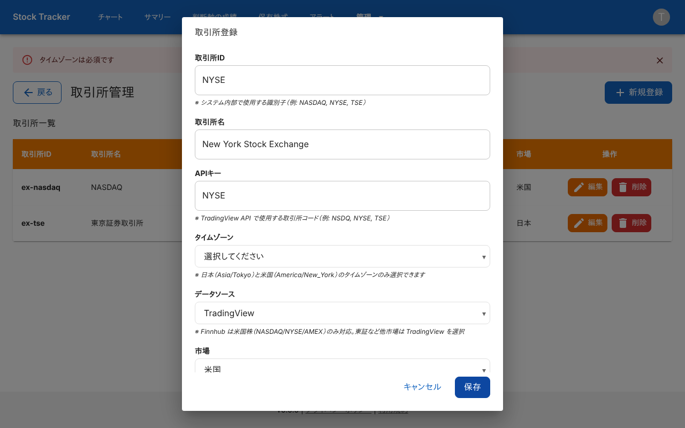 |

### 編集ダイアログ

取引所 ID と API キーは表示のみ。

| スマホ | PC |
|---|---|
| 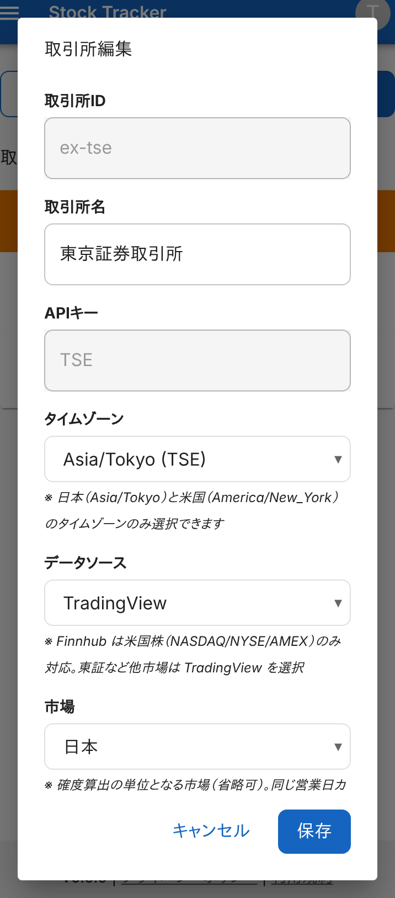 | 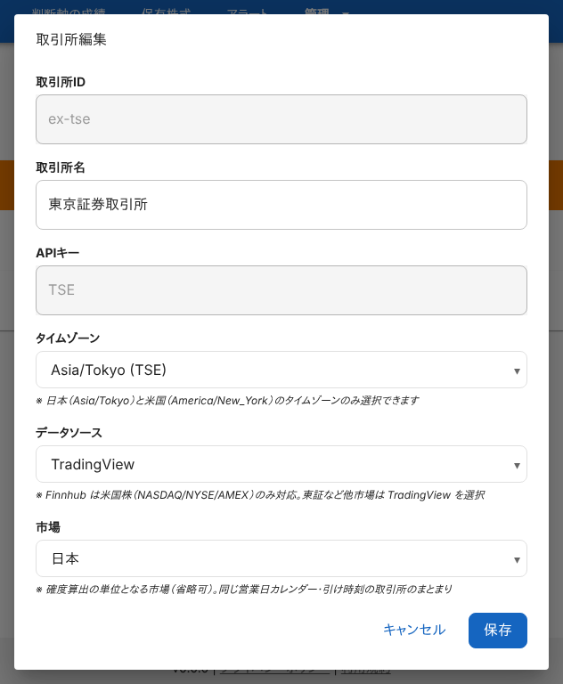 |

### 削除の確認

| スマホ | PC |
|---|---|
| 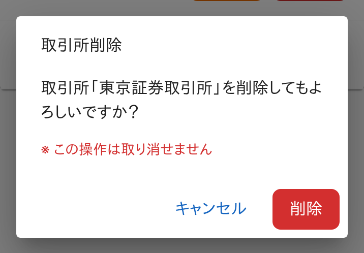 | 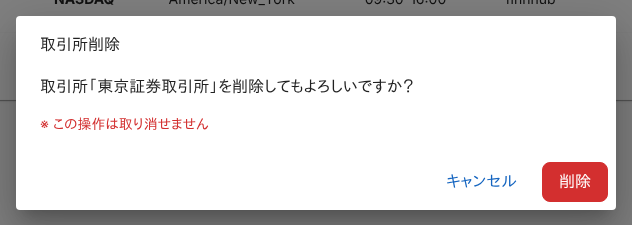 |

### 権限がないとき (`stock-viewer`)

「権限エラー」だけを出す。

| スマホ | PC |
|---|---|
|  |  |

## つながり

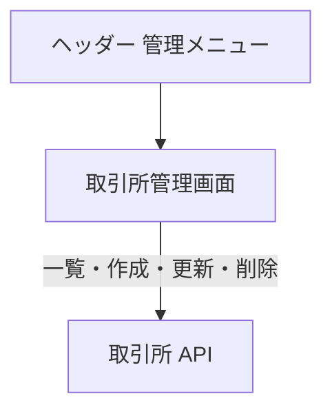
