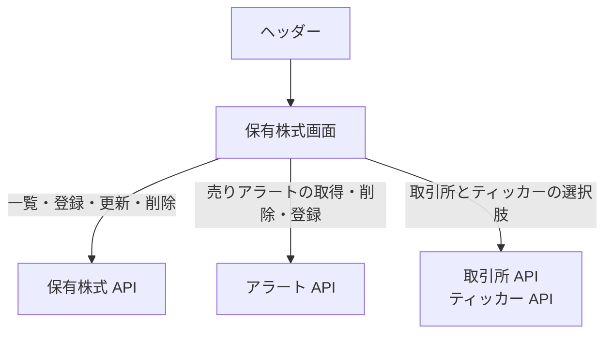

# 保有株式画面

自分の保有株式の一覧と、登録、編集、削除、売りアラートの設定を行う。

## 入口

- パスは `/holdings`。ヘッダーの「保有株式」と、トップ画面のクイックアクションから来る

## 表示の条件

- 一覧は `stocks:read` で見られる。「新規登録」、売りアラート、編集、削除は `stocks:write-own` を持つときだけ出る ([権限とロール](../term/permission.md))

## 表示するもの

| 部分 | 内容 |
|---|---|
| 一覧 | 列は取引所、ティッカー (シンボルと銘柄名)、保有数、平均取得価格、通貨。書き込み権限があれば、アラートと操作の列が付く |
| アラートの列 | 有効な売りアラートがある銘柄は「アラート設定済」、なければ「売りアラート」のボタン |
| 登録・編集の入力 | 取引所、ティッカー、保有数、平均取得価格、通貨 |

- 登録では、取引所を選ぶとティッカーが絞られる。通貨は `USD` か `JPY` から選び、初期値は取引所の市場から決まる (日本は `JPY`、米国は `USD`、市場が未設定なら空)
- 編集では、取引所、ティッカー、通貨は表示のみで、保有数と平均取得価格を変えられる
- 入力は、保有数が 0.0001〜1,000,000,000、平均取得価格が 0.01〜1,000,000 の範囲でなければ登録できない

## 状態

- 読み込み中は読み込み表示を出す
- 0 件のときは「保有株式がありません」
- 削除の前に売りアラートを取っている間は「削除対象の売りアラートを確認しています...」を出し、削除を確定できない

## 操作

| 操作 | 結果 |
|---|---|
| 新規登録する | [保有株式 API](../api/holdings.md) に登録し、一覧を読み直す |
| 編集する | 保有数と平均取得価格を[保有株式 API](../api/holdings.md) で更新する |
| 削除する | その銘柄の売りアラートを[アラート API](../api/alerts.md) から取り、確認の中に並べる。確定すると保有株式を削除し、続けて売りアラートも削除する。売りアラートの削除に失敗したものがあれば、その旨を出す |
| 売りアラートを設定する | 売りのアラート設定ダイアログを開く。目標価格の初期値は平均取得価格の 1.2 倍、割合入力の基準は平均取得価格。登録は[アラート API](../api/alerts.md) |

- 一覧の取得は 1 回だけで、最初の 50 件までを表示する (続きは取りにいかない)

## つながり

