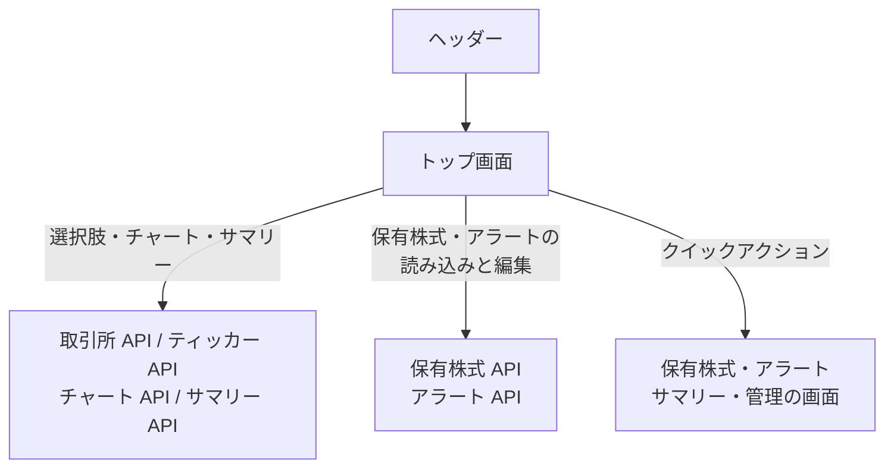

# トップ画面 (チャート)

取引所と銘柄を選び、株価チャートと、その銘柄のサマリー・保有株式・アラートを 1 画面で見る。保有株式とアラートはその場で登録、編集、削除できる。

## 入口

- パスは `/`。ヘッダーの「チャート」から来る
- 問い合わせの `exchangeId`、`tickerId`、`timeframe` で、開いた時点の選択を決められる。存在しない取引所・銘柄は無視する
- 利用者が選択を変えると、選択が問い合わせに反映される。`timeframe` は初期値の 1 時間足のときは付けない

## 表示するもの

| 部分 | 内容 |
|---|---|
| 選択 | 取引所、ティッカー (取引所を選ぶと絞られる)、時間枠 (1 分足・5 分足・1 時間足・日足。初期値は 1 時間足)、表示本数 (10・30・50・100 本。初期値は 100) |
| チャート | 選んだ銘柄の足。保有株式があれば平均取得価格の線、有効なアラートの価格の線 (上限・下限) を重ねる。未選択のときは選択を促す表示 |
| サマリー | 方向と荒れの[確度](../term/forecast.md)と確率、点灯したパターン数、更新日時。「詳細」で確度の内訳・日足チャート・足の値を開く |
| 保有株式 | 数量、平均取得価格、通貨 |
| アラート | その銘柄のアラートの一覧 |
| クイックアクション | 保有株式、アラート、サマリーへのリンク。取引所管理とティッカー管理へのリンクは、`stocks:manage-data` を持つときだけ出る |

## 表示の条件

- 追加・編集・削除のボタンは `stocks:write-own` を持つときだけ出る ([権限とロール](../term/permission.md))

## 状態

- 取引所・ティッカー・サマリー・保有株式・アラートは、それぞれ別に読み込む。1 つ失敗しても、ほかは表示する
- サマリーがない銘柄は「サマリー情報がありません」を出す
- 保有株式がない銘柄だけ「追加」できる (通貨は取引所の市場から初期値が決まる)。アラートの一覧が空のときは、その旨を出す

## 操作

| 操作 | 結果 |
|---|---|
| 取引所を選ぶ | ティッカーを絞って読み直す。ティッカーの選択は外れる |
| ティッカーを選ぶ | チャート、サマリー、保有株式、アラートを読む |
| 自動更新を入れる | チャートを 10 秒ごとに読み直す |
| 保有株式を追加・編集する | [保有株式 API](../api/holdings.md) で登録・更新し、保有株式とアラートを読み直す |
| 保有株式を削除する | 削除前にその銘柄の売りアラートを取り、確認の中に出す。[保有株式 API](../api/holdings.md) で削除したあと、売りアラートも[アラート API](../api/alerts.md) で削除する。売りアラートの削除に失敗したものがあれば、その旨を出す |
| アラートの「買い追加」「売り追加」 | アラート設定ダイアログで[アラート API](../api/alerts.md) に登録する。初めて登録するときは通知の許可を求める |
| アラートを編集・削除する | [アラート API](../api/alerts.md) で更新・削除し、読み直す |

読み込みは、[取引所 API](../api/exchanges.md)、[ティッカー API](../api/tickers.md)、[チャート API](../api/chart.md)、[サマリー API](../api/summaries.md)、[保有株式 API](../api/holdings.md)、[アラート API](../api/alerts.md) を使う。

## つながり

