# サマリー画面

取引所ごとに、その日の銘柄の[確度](../term/forecast.md)、点灯したパターン数、アラート数を並べて見る。銘柄を選ぶと、確度の内訳とチャートを開く。

## 入口

- パスは `/summaries`。ヘッダーの「サマリー」と、トップ画面のクイックアクションから来る

## 表示の条件

- 「サマリー更新」ボタンは `stocks:manage-data` を持つときだけ出る ([権限とロール](../term/permission.md))
- 詳細のアラート設定ボタンは `stocks:write-own` を持つときだけ出る。売りは、保有している銘柄だけに出る

## 表示するもの

| 部分 | 内容 |
|---|---|
| 市場の荒れ予報 | 日本と米国の、翌営業日に市場全体が平常より荒れる確率と「ふだん」。取引所の絞り込みに関係なく両方を出す。評価日数が足りない間は「参考値」の注記が付く |
| 取引所の絞り込み | 「すべての取引所」か 1 つ |
| 取引所ごとのカード | 取引所名、対象日、最新の更新日時。表は下の列 |

| 列 | 内容 |
|---|---|
| シンボル、銘柄名 | 銘柄 |
| 保有 | 保有していれば ✓、なければ - |
| 方向、荒れ | 寄りの言葉 (強含み・弱含み・中立、荒れそう・平常)。確度がなければ「—」 |
| 点灯 | 点灯したパターンの数と、買い・売りの内訳 |
| 買いアラート数、売りアラート数 | 有効なアラートの数。無効のものがあれば `N (無効の数)` |

- 銘柄の表は、幅が足りないときは横にスクロールする
- 詳細の内訳の表は、幅 600px 未満では「軸名」「寄与」だけを出す。行を開くと、値と過去成績が下に出る
- 「方向」「荒れ」の見出しを押すと、確率の降順、昇順、並べ替えなしの順に切り替わる。確度のない銘柄は末尾に残る

## 状態

- 読み込み中は「読み込み中...」
- 銘柄がない取引所は「データがありません」
- 取得に失敗したときはエラーを出し、表は空にする

## 操作

| 操作 | 結果 |
|---|---|
| 開く・取引所を絞る | [サマリー API](../api/summaries.md) の一覧を読む。絞り込みは画面側で行う |
| 「サマリー更新」を押す | [サマリー API](../api/summaries.md) で[サマリーバッチ](../batch/summary.md)を起動し、「サマリーバッチを実行しました」を出して一覧を読み直す。バッチの完了は待たない |
| 銘柄の行を押す | 詳細ダイアログを開く |
| 詳細で内訳のタブを切り替える | 「方向の内訳」「荒れの内訳」を切り替える。点灯していない点灯型の軸は、折りたたみにまとまる |
| 詳細で買い・売りのアラートを設定する | アラート設定ダイアログを開く。目標価格の初期値は終値。登録は[アラート API](../api/alerts.md) |

詳細ダイアログの中身は、方向・荒れの確度と軸別の内訳 ([確度 API](../api/forecasts.md))、日足 50 本のチャート ([チャート API](../api/chart.md))、始値・高値・安値・終値・出来高・保有数・平均取得価格・更新日時。確度がないときは、その理由 (確度なし、または履歴不足) を出す。

## 画面の見た目

### 通常表示

市場の荒れ予報と、取引所ごとのカードを並べる。確度がない銘柄は「—」になる。

| スマホ | PC |
|---|---|
| 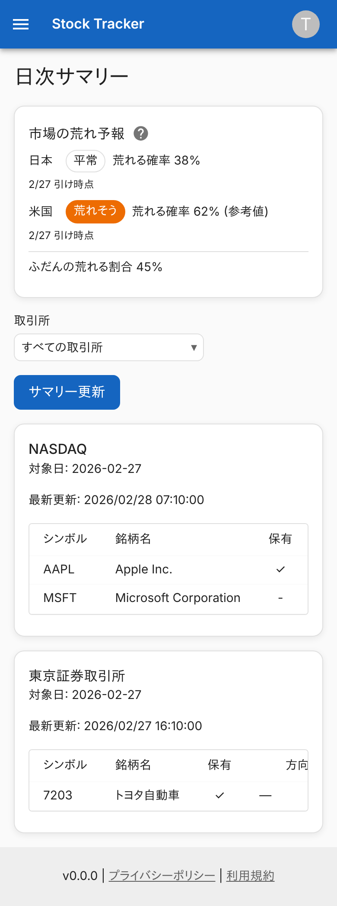 | 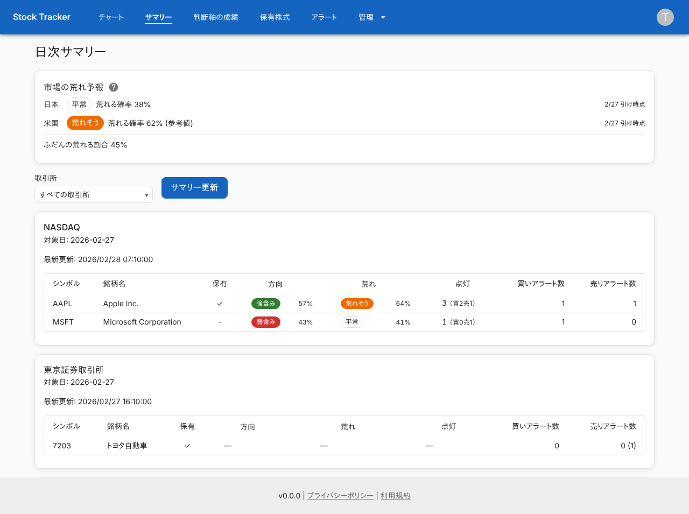 |

### 方向の列で並べ替えた状態

見出しを押すと確率順に並ぶ。

| スマホ | PC |
|---|---|
| 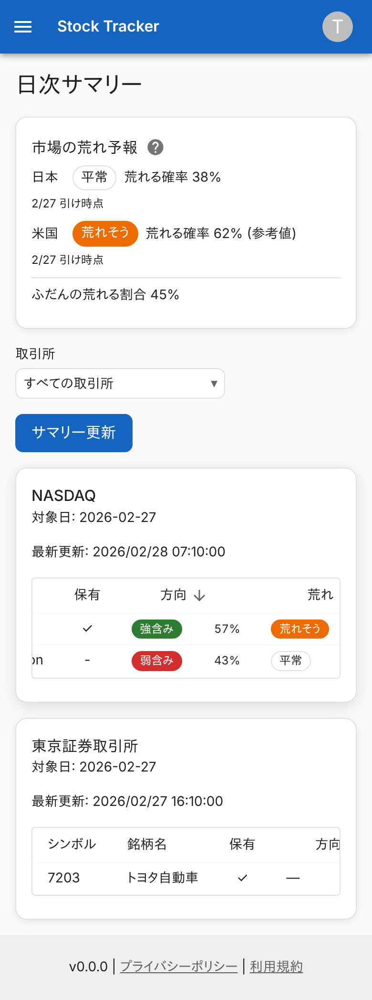 |  |

### 銘柄の詳細ダイアログ

方向と荒れの確度、方向の内訳、日足チャートを出す。縦に長いため、チャートはダイアログの中をスクロールして見る。

| スマホ | PC |
|---|---|
| 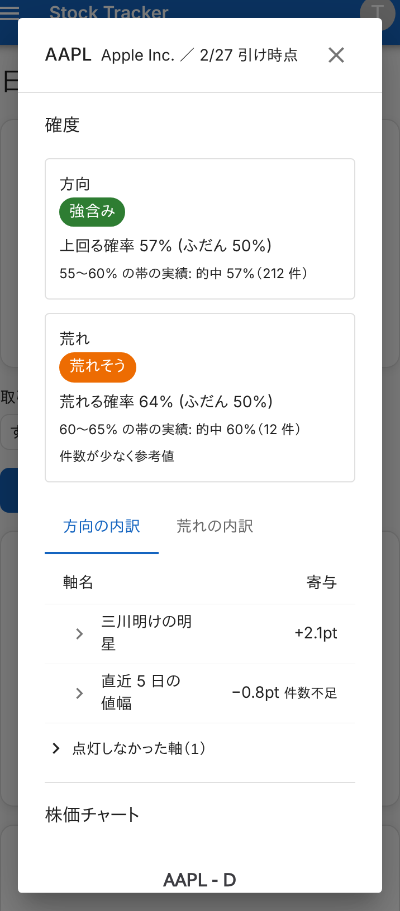 | 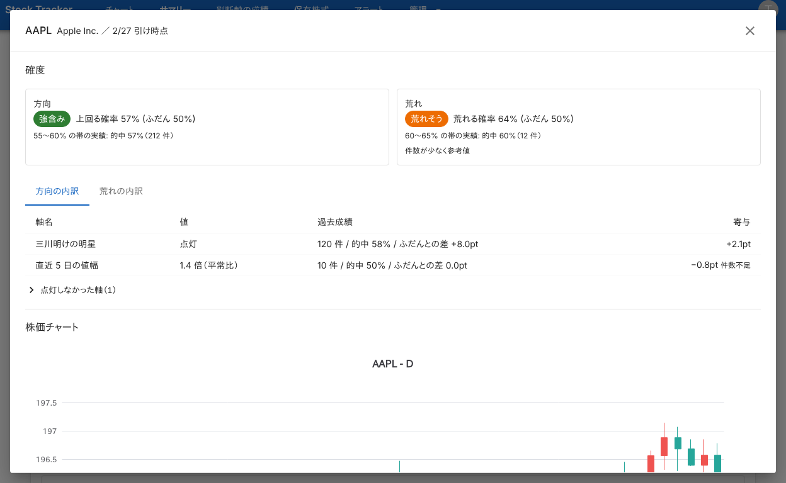 |

### 荒れの内訳に切り替えた状態

| スマホ | PC |
|---|---|
| 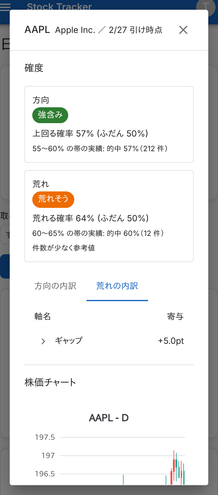 | 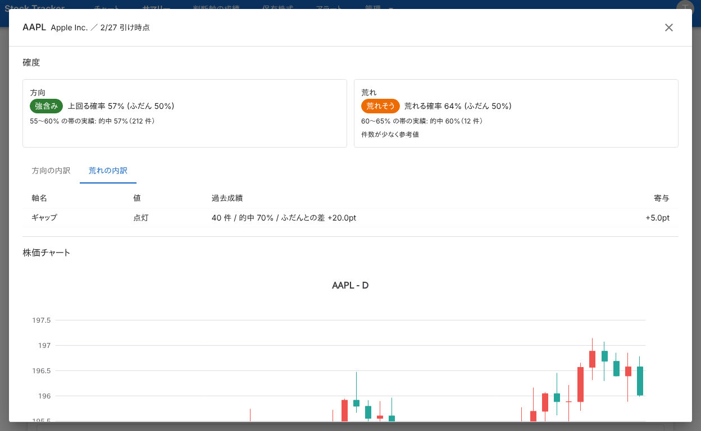 |

### 確度がない銘柄の詳細

確度がない理由を出す。

| スマホ | PC |
|---|---|
| 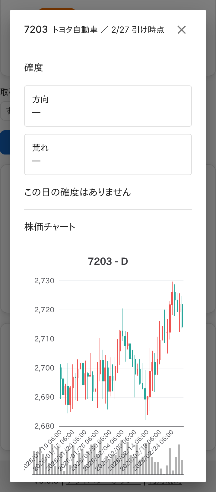 | 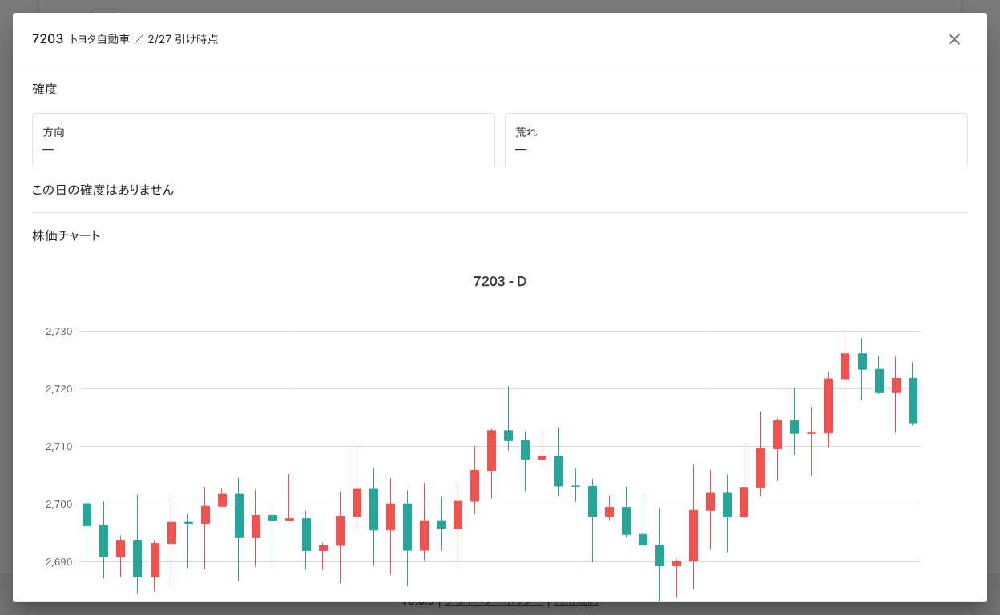 |

### 銘柄がない取引所

「データがありません」を出す。

| スマホ | PC |
|---|---|
| 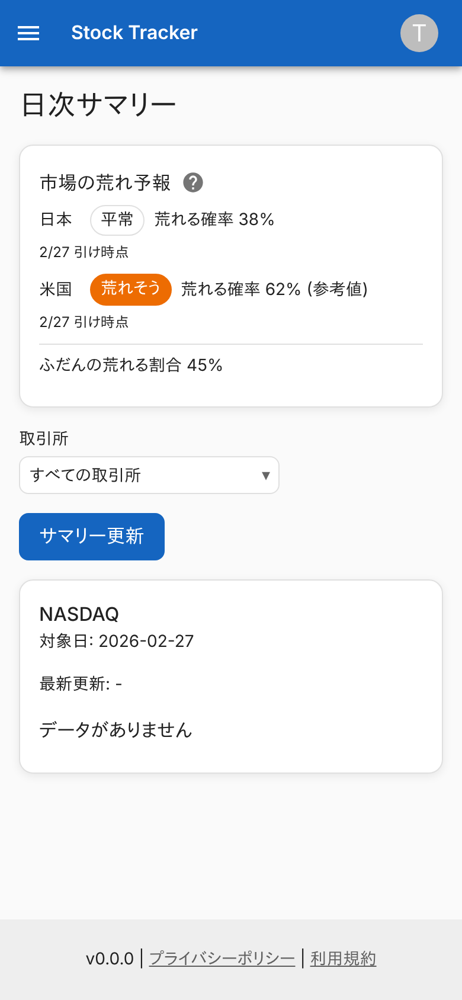 | 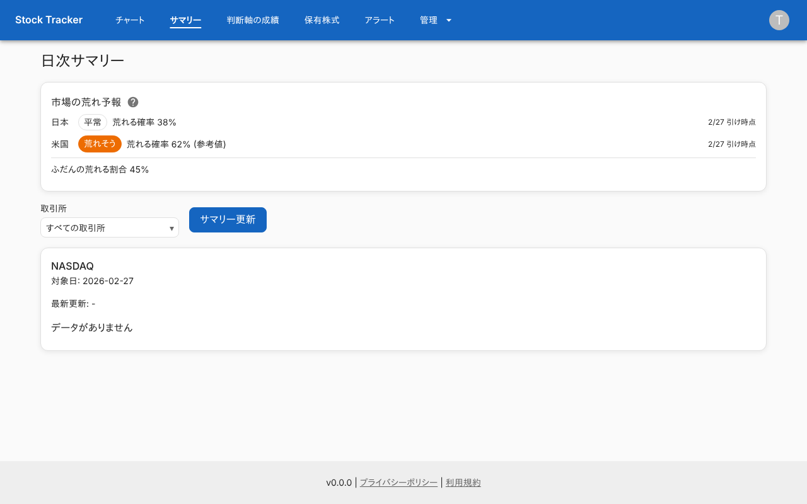 |

### 取得に失敗したとき

エラーを出し、表は空にする。

| スマホ | PC |
|---|---|
| 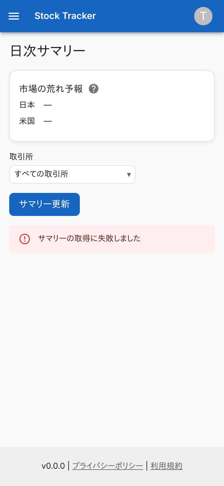 | 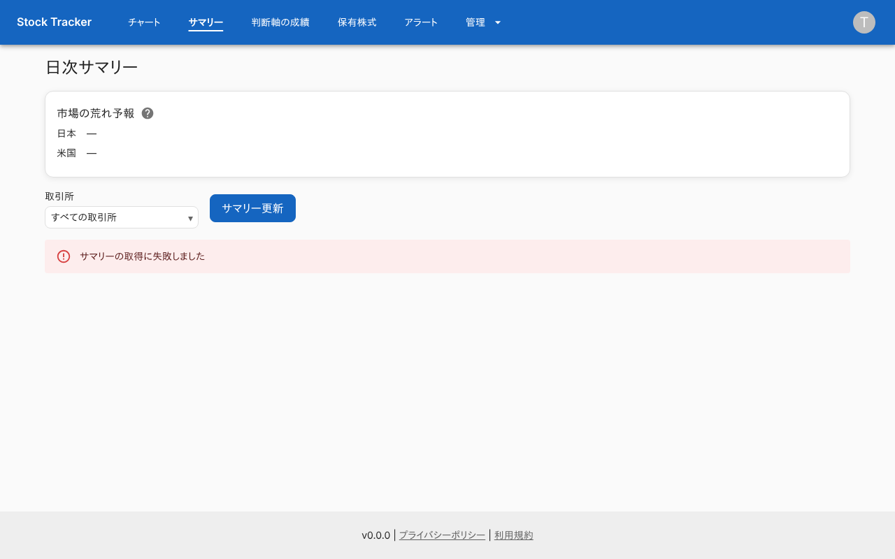 |

### 書き込みの権限だけを持つロール (`stock-user`)

「サマリー更新」のボタンが出ない。

| スマホ | PC |
|---|---|
|  |  |

## つながり

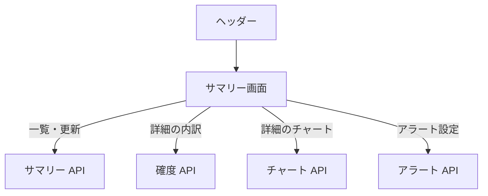
