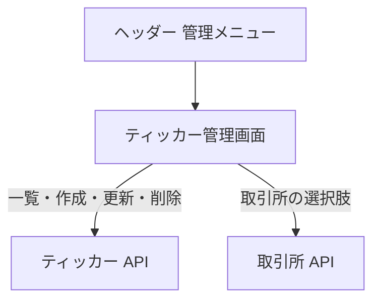

# ティッカー管理画面

銘柄マスタ (ティッカー) の一覧と、作成、銘柄名の編集、削除を行う管理画面。

## 入口

- パスは `/tickers`。ヘッダーの「管理」メニューの「ティッカー」から来る

## 表示の条件

- `stocks:manage-data` を持つ利用者だけ。権限がなければ、一覧を読まずに「権限エラー」を出す ([権限とロール](../term/permission.md))
- セッションの確認中は「セッション情報を確認中...」を出す

## 表示するもの

| 部分 | 内容 |
|---|---|
| 取引所での絞り込み | 取引所を選ぶと、その取引所のティッカーだけにする。選ばなければ全件 |
| 一覧 | 列は[ティッカー ID](../term/ticker-id.md)、シンボル、銘柄名、取引所、操作 |

## 状態

- 読み込み中は一覧の中にインラインの表示を出す
- 0 件のときは「ティッカーが登録されていません」
- 401 / 403 のときは、権限がない旨のエラーを出す

## 操作

| 操作 | 結果 |
|---|---|
| 作成する | シンボル、銘柄名、取引所を入力して[ティッカー API](../api/tickers.md) に登録する。ティッカー ID は取引所の `key` とシンボルから決まる。成功すると一覧を読み直す |
| 編集する | 銘柄名だけ変えられる (ティッカー ID、シンボル、取引所は表示のみ)。銘柄名が空のときは更新できない |
| 削除する | 確認のあとに削除する。関連する保有株式やアラートは確認しない |
| 取引所を絞り込む | 絞り込んで読み直す |

取引所の選択肢は[取引所 API](../api/exchanges.md) から読む。

## つながり

