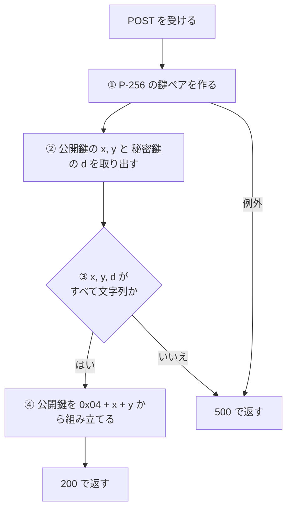
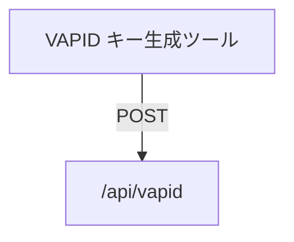

# VAPID キー API

[VAPID キー](../term/vapid-key.md)のペアを 1 組作って返す API。ログインは要らない。

## エンドポイント

| メソッド | パス | 権限 |
|---|---|---|
| POST | `/api/vapid` | なし |

POST 以外のメソッドは定義していない。

## 入力と出力

- 入力はない。呼び出し元 ([VAPID キー生成ツール](../screen/vapid-generator.md)) は、本文なしで `Content-Type: application/json` だけを付けて送る
- 成功すると 200 で `{ publicKey, privateKey }` を返す。どちらも文字列で、形式は [VAPID キー](../term/vapid-key.md)のとおり
- 呼ぶたびに新しい鍵を作る。保存はしない

## 処理

## エラー

| 条件 | 結果 |
|---|---|
| 鍵の生成で例外になった、または取り出した値の形式が不正 | 500 で `{ error: 'VAPIDキーの生成に失敗しました。' }`。原因はサーバーのログに残る (応答には含めない) |

## つながり

