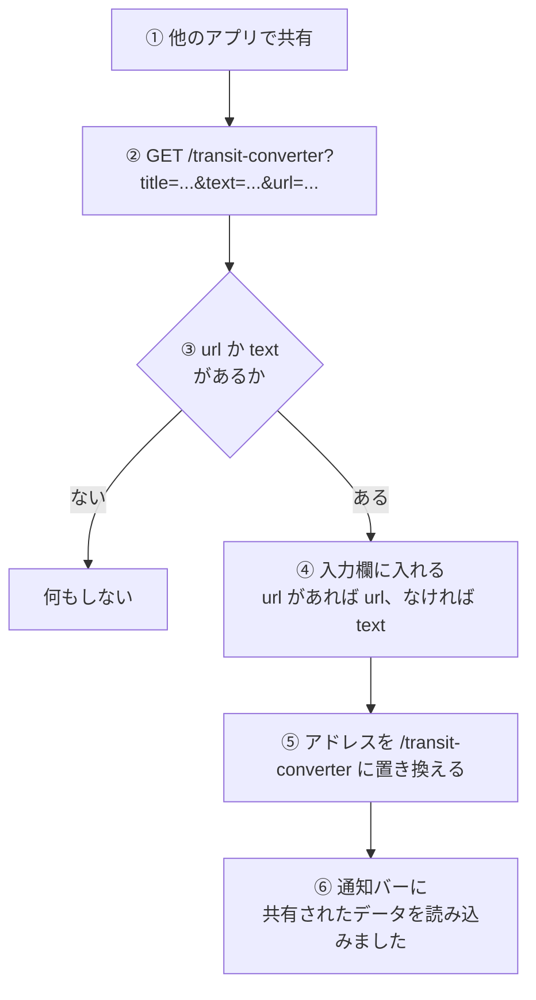

# 共有シートからの取り込み

他のアプリで共有した乗り換え案内を、[乗り換え変換ツール](../screen/transit-converter.md)の入力欄に入れる経路 (Web Share Target)。

## 起点

- 他のアプリの共有シートで Tools を選ぶ。Tools が共有先に出るかは、ブラウザと OS が決める
- マニフェスト (`/manifest.json`) の `share_target` が、共有されたものの届け先を決めている

| 項目 | 値 |
|---|---|
| 届け先 | `/transit-converter` |
| メソッド | GET |
| 受け取る項目 | `title`、`text`、`url` (URL のクエリで届く) |

- マニフェストはほかに、アプリ名「Tools - 便利な開発ツール集」、短い名前「Tools」、開始 URL `/`、表示モード `standalone`、テーマ色 `#1976d2`、アイコン (192px と 512px) を持つ
- Service Worker は登録しない。オフライン用のキャッシュを作る処理も、[オフライン画面](../screen/offline.md)へ切り替える処理もない

## 経路

- `title` は使わない
- 入れるだけで、変換は自動では始まらない。利用者が「変換」を押す
- アドレスの置き換えでは、ブラウザの履歴を増やさず、今のエントリを書き換える。クエリは消える

## 届く先

- 乗り換え変換ツールの入力欄と、[通知バー](../term/snackbar.md)。ほかのツールには届かない
- 入力欄の中身は、そのとき入っていた文字列を置き換える

## 失敗・取りこぼしのとき

- 共有された内容は、入れる前には検証しない。「変換」を押したとき、通常の入力と同じ検証を受ける
- URL だけが共有されたときは、「⇒」を含まないため、「乗り換え案内のテキストを正しく解析できませんでした。」になる (URL の先は取りに行かない)
