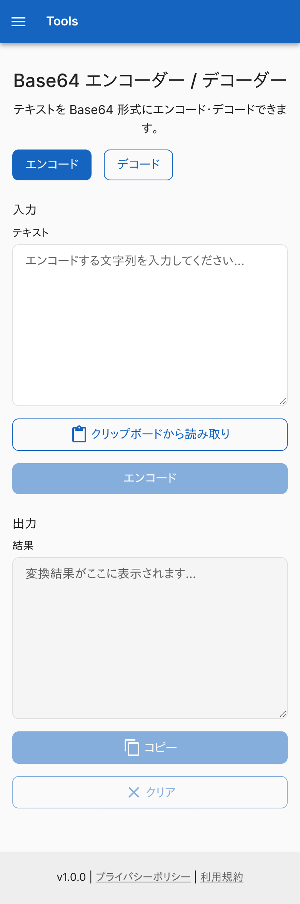
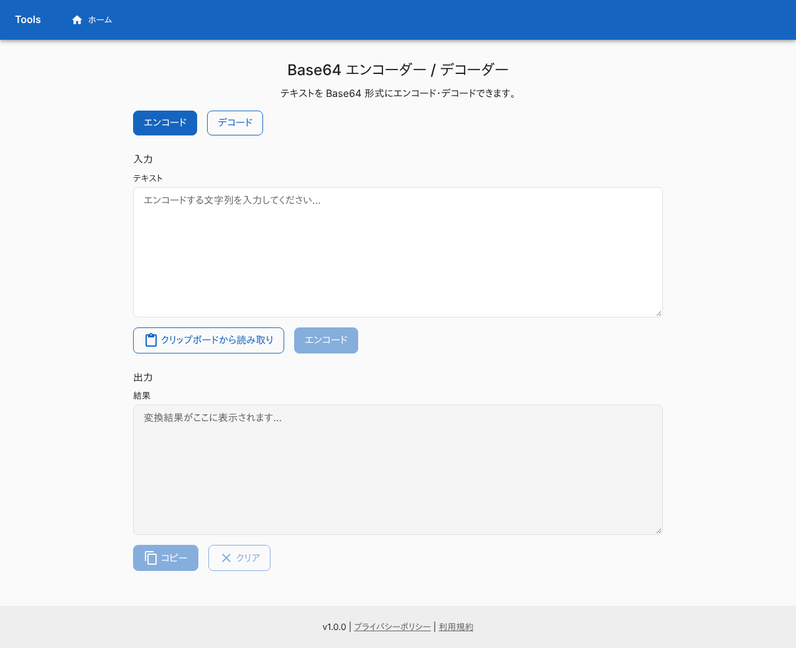
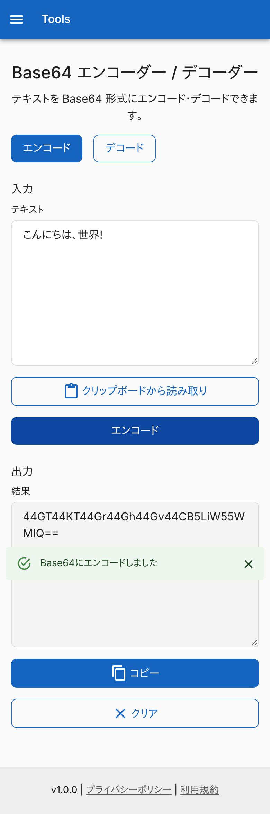
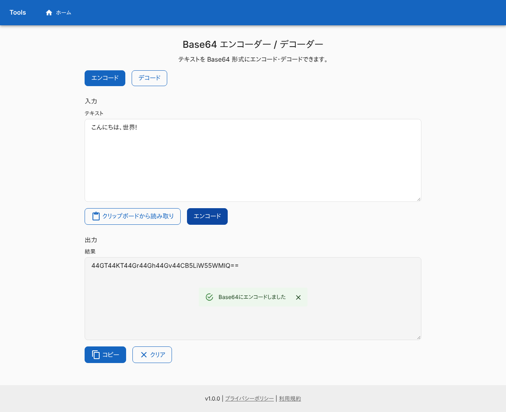
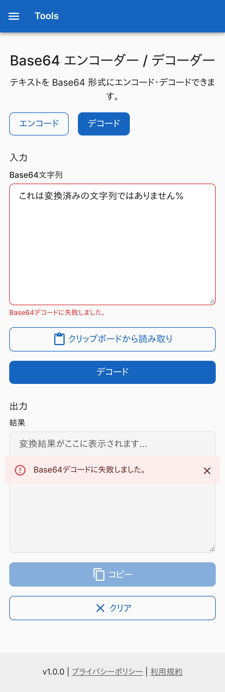
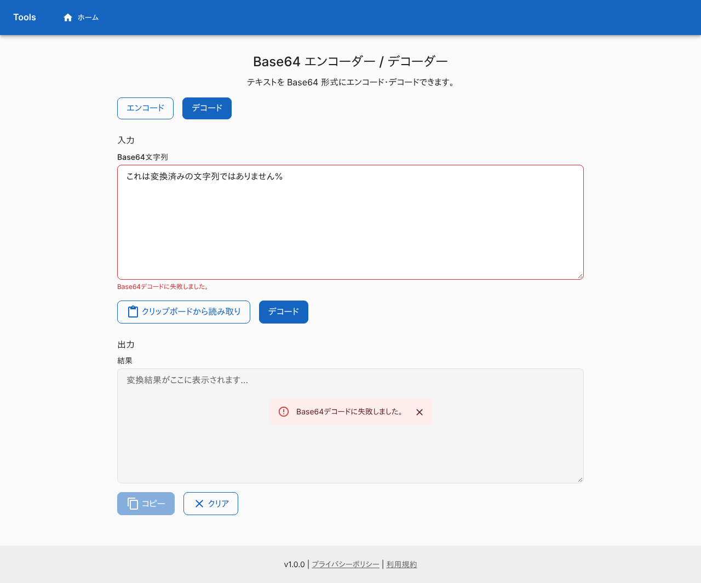
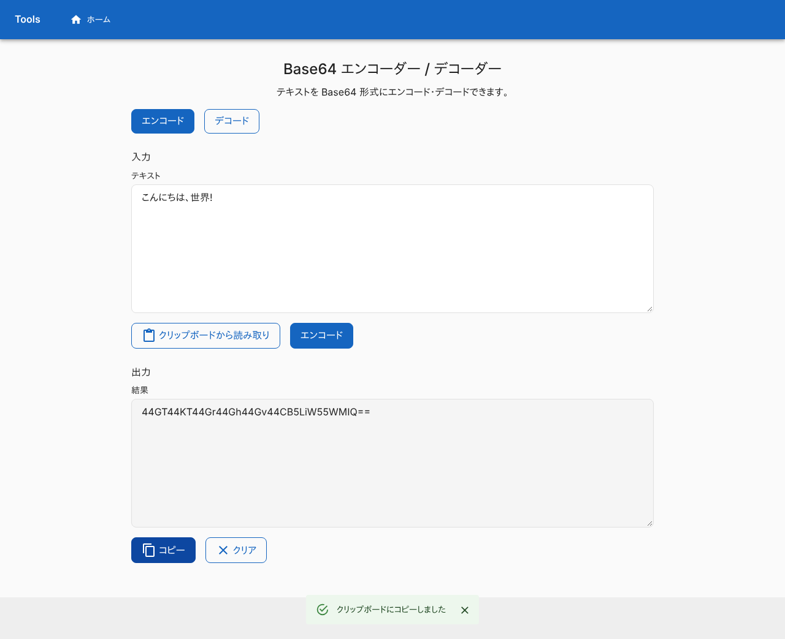
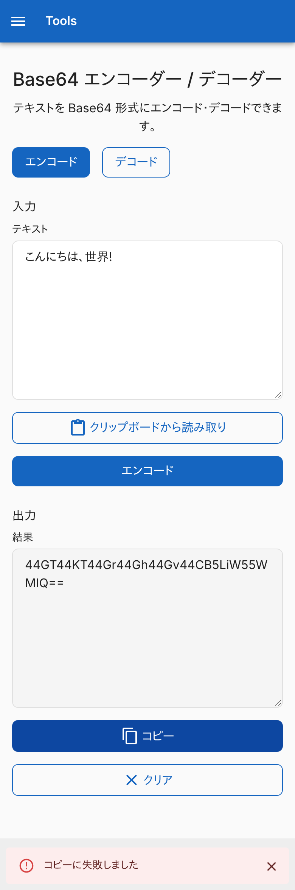
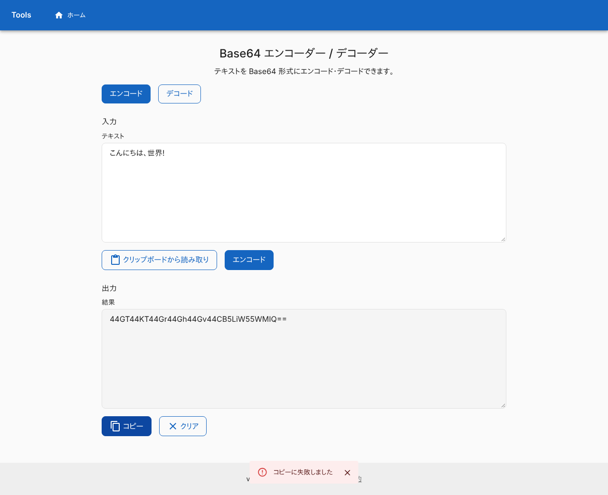
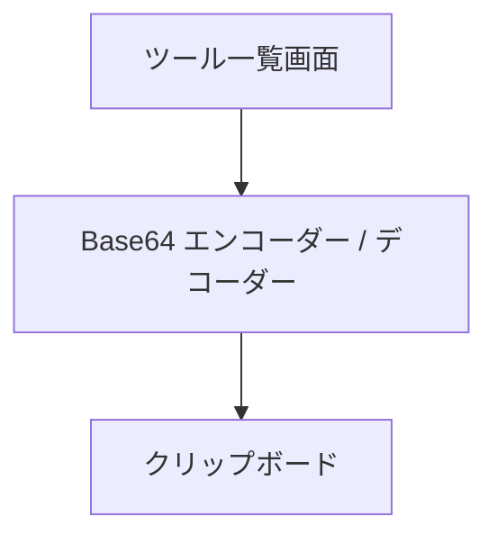

# Base64 エンコーダー / デコーダー

テキストを Base64 にエンコードし、Base64 の文字列をテキストにデコードする画面。変換はブラウザの中で終わり、入力は外へ送らない。ログインは要らない。

## 入口

- パスは `/base64`
- [ツール一覧画面](./home.md)のカードと、ヘッダーのタイトル・ナビゲーションから来る (ヘッダーは全画面共通)

## 表示の条件

- 初回の訪問では、[初回訪問ダイアログ](../term/migration-dialog.md)が前面に出て、閉じるまでこの画面は操作できない

## 表示するもの

上から次の順に並ぶ。ヘッダーとフッターは全画面共通で、[ツール一覧画面](./home.md)に書いてある。

| 部分 | 内容 |
|---|---|
| 見出し | 「Base64 エンコーダー / デコーダー」と、使い方の説明 |
| モード | 「エンコード」「デコード」の 2 つのボタン。選んでいるほうが塗りつぶし。初めは「エンコード」 |
| 入力 | 複数行 (8 行) の入力欄と、「クリップボードから読み取り」、変換のボタン (モードの名前) |
| 出力 | 読み取り専用の複数行 (8 行)「結果」と、「コピー」「クリア」 |

モードで変わる文言。

| 部分 | エンコード | デコード |
|---|---|---|
| 入力欄のラベル | テキスト | Base64文字列 |
| 変換のボタン | エンコード | デコード |
| 成功の通知 | Base64にエンコードしました | Base64をデコードしました |

## 状態

- 初めは変換のボタン、「コピー」、「クリア」が押せない。変換のボタンは入力が空白だけのとき、「コピー」は出力が空のとき、「クリア」は入力も出力も空のときに押せない
- モードを切り替えると、出力とエラーを消す。入力は残る
- 変換に失敗すると、[通知バー](../term/snackbar.md) (失敗) と、入力欄の赤枠と下の文に出す。出力は前の結果のまま残る。エラーは、次に成功するか、モードの切り替えか、「クリア」か、「クリップボードから読み取り」で消える

| モード | 失敗の条件 | メッセージ |
|---|---|---|
| エンコード | UTF-8 にできない、または Base64 に変換できない (通常は起きない) | Base64エンコードに失敗しました。 |
| デコード | Base64 として正しくない (下) | Base64デコードに失敗しました。 |

## 変換のしかた

- エンコード: 入力を UTF-8 のバイト列にして、標準の Base64 (`A-Z a-z 0-9 + /`、末尾は `=` でそろえる) にする。入力の前後の空白もそのまま変換する
- デコード: 入力の前後の空白を除いて確かめる。次をすべて満たすとき、バイト列を UTF-8 の文字列にして出す
    - 長さが 4 の倍数
    - 文字が `A-Z a-z 0-9 + /` で、末尾だけ `=` が 1〜2 個
- 途中の空白や改行、URL セーフ形式 (`-` と `_`) は、正しくない入力として扱う。UTF-8 として読めないバイトは、エラーにならず置換文字 (U+FFFD) になる

## 操作

| 操作 | 結果 |
|---|---|
| 「エンコード」「デコード」 (モード) | モードを切り替える。出力とエラーを消す |
| 「クリップボードから読み取り」 | [クリップボード操作](../term/clipboard-actions.md)のとおり、入力欄を置き換える |
| 変換のボタン | 上のとおり変換して、出力欄に入れる |
| 「コピー」 | 出力欄の文字列を[クリップボードへ書く](../term/clipboard-actions.md) |
| 「クリア」 | 入力・出力・エラーを消す。モードは変えない |

API は呼ばない。

## 画面の見た目

### 通常表示

エンコードモード。入力前。

| スマホ | PC |
|---|---|
|  |  |

### エンコードした

日本語の文字列をエンコードした例。「Base64にエンコードしました」を出す。

| スマホ | PC |
|---|---|
|  |  |

### デコードに失敗したとき

デコードモードで、Base64 でない文字列を入れた例。「Base64デコードに失敗しました。」を出す。

| スマホ | PC |
|---|---|
|  |  |

### 結果をコピーした

「クリップボードにコピーしました」を出す。

| スマホ | PC |
|---|---|
|  |  |

### コピーに失敗したとき

クリップボードを使えない例。「コピーに失敗しました」を出す。

| スマホ | PC |
|---|---|
|  |  |

## つながり

