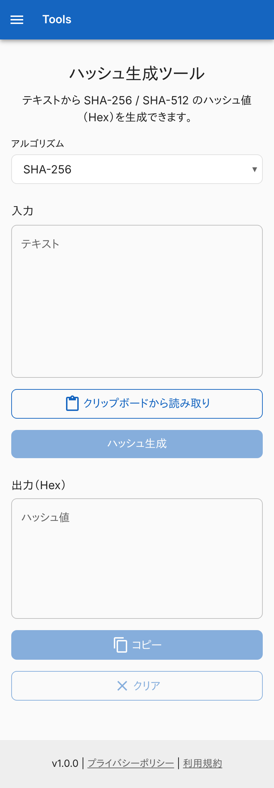
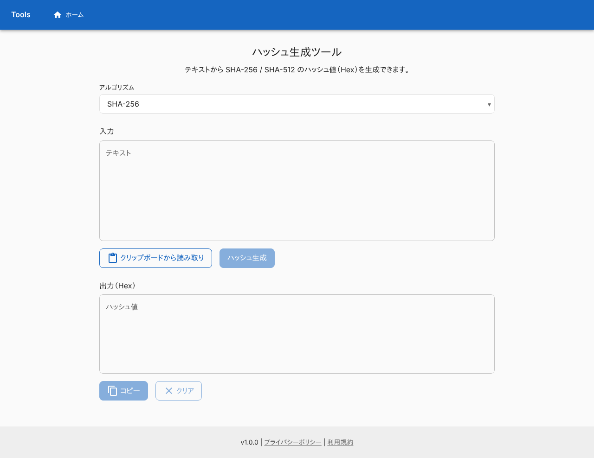
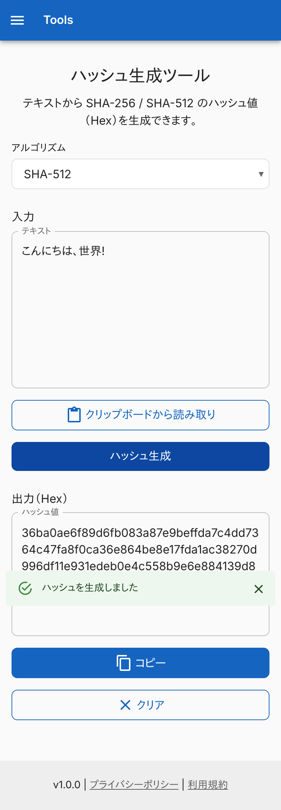
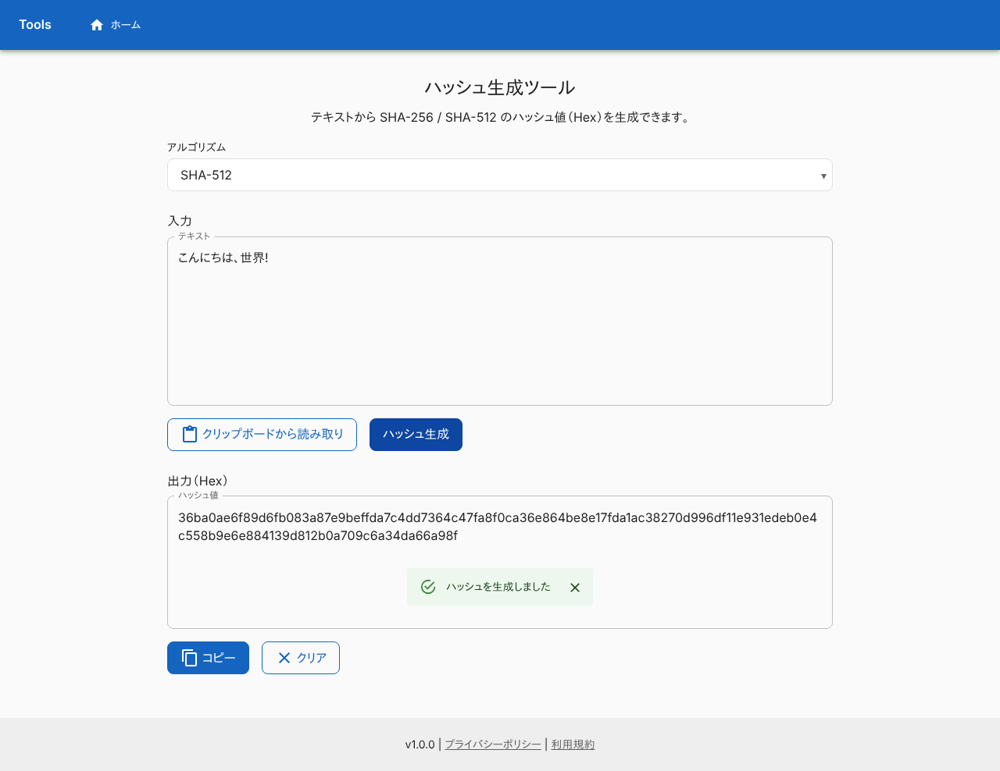
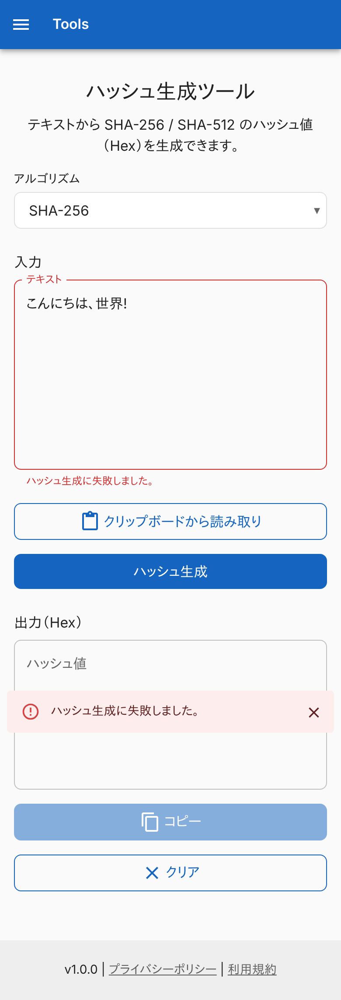
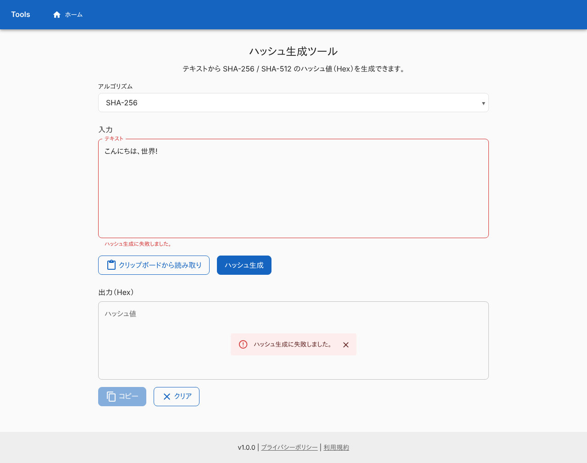
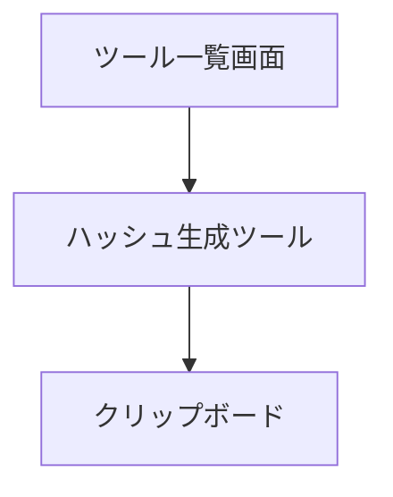

# ハッシュ生成ツール

文字列から SHA-256 か SHA-512 のハッシュ値を、16 進数 (Hex) で作る画面。計算はブラウザの中で終わり、入力は外へ送らない。ログインは要らない。

## 入口

- パスは `/hash-generator`
- [ツール一覧画面](./home.md)のカードと、ヘッダーのタイトル・ナビゲーションから来る (ヘッダーは全画面共通)

## 表示の条件

- 初回の訪問では、[初回訪問ダイアログ](../term/migration-dialog.md)が前面に出て、閉じるまでこの画面は操作できない

## 表示するもの

上から次の順に並ぶ。ヘッダーとフッターは全画面共通で、[ツール一覧画面](./home.md)に書いてある。

| 部分 | 内容 |
|---|---|
| 見出し | 「ハッシュ生成ツール」と、使い方の説明 |
| アルゴリズム | 選択欄。`SHA-256` (初期値)、`SHA-512` |
| 入力 | 複数行 (8 行) の「テキスト」と、「クリップボードから読み取り」「ハッシュ生成」 |
| 出力 (Hex) | 読み取り専用の複数行 (6 行)「ハッシュ値」と、「コピー」「クリア」 |

## 状態

- 初めは「ハッシュ生成」「コピー」「クリア」が押せない。「ハッシュ生成」は入力が空白だけのとき、「コピー」は出力が空のとき、「クリア」は入力も出力も空のときに押せない
- アルゴリズムを切り替えても、出力は変わらない。切り替えたあとに「ハッシュ生成」を押すと、新しい値で置き換わる
- 失敗すると、「ハッシュ生成に失敗しました。」を[通知バー](../term/snackbar.md) (失敗) と、入力欄の赤枠と下の文に出す。出力は前の結果のまま残る。ブラウザが暗号の機能 (`crypto.subtle`) を持たないとき (HTTPS でない接続など) に起きる

## 計算のしかた

- 入力を UTF-8 のバイト列にして、選んだアルゴリズムでハッシュを取り、小文字の 16 進数にする。長さは SHA-256 が 64 文字、SHA-512 が 128 文字
- 入力の前後の空白や改行もそのまま計算に含める

## 操作

| 操作 | 結果 |
|---|---|
| アルゴリズムを選ぶ | 選択を切り替える。何も計算しない |
| 「クリップボードから読み取り」 | [クリップボード操作](../term/clipboard-actions.md)のとおり、入力欄を置き換える |
| 「ハッシュ生成」 | 上のとおり計算して、出力欄に入れる。「ハッシュを生成しました」(成功) |
| 「コピー」 | 出力欄の文字列を[クリップボードへ書く](../term/clipboard-actions.md) |
| 「クリア」 | 入力・出力・エラーを消す。アルゴリズムは変えない |

API は呼ばない。

## 画面の見た目

### 通常表示

SHA-256 を選んだ状態。入力前。

| スマホ | PC |
|---|---|
|  |  |

### 生成した

SHA-512 を選び、日本語の文字列から作った例。「ハッシュを生成しました」を出す。

| スマホ | PC |
|---|---|
|  |  |

### 生成に失敗したとき

ブラウザが暗号の機能を持たない例。「ハッシュ生成に失敗しました。」を出す。

| スマホ | PC |
|---|---|
|  |  |

## つながり

