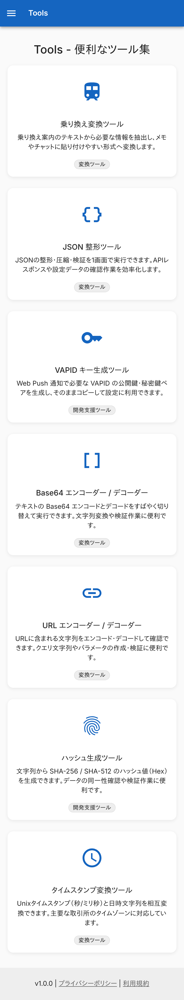
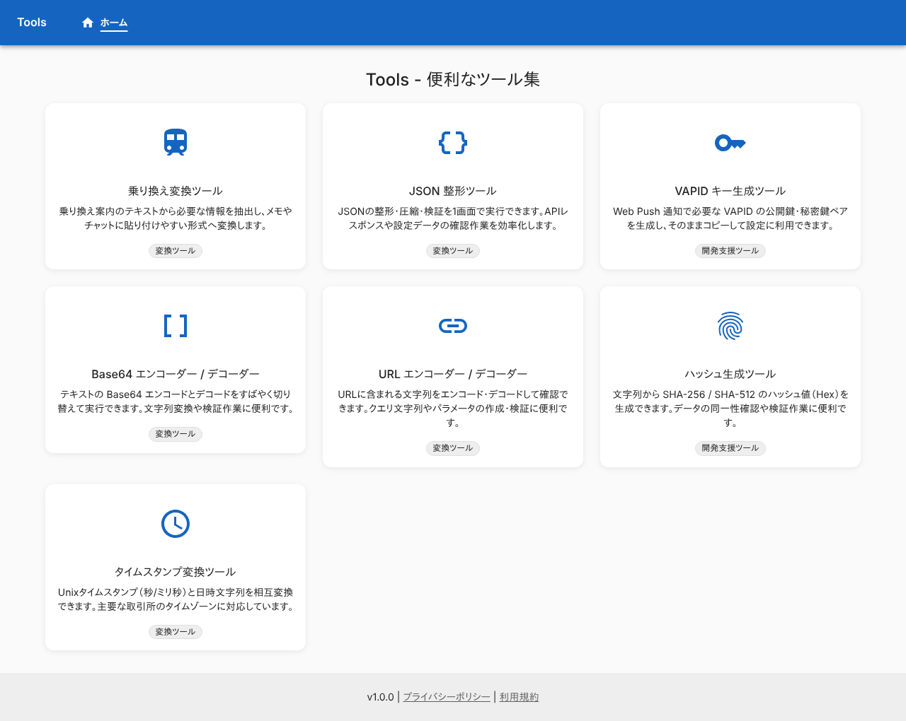
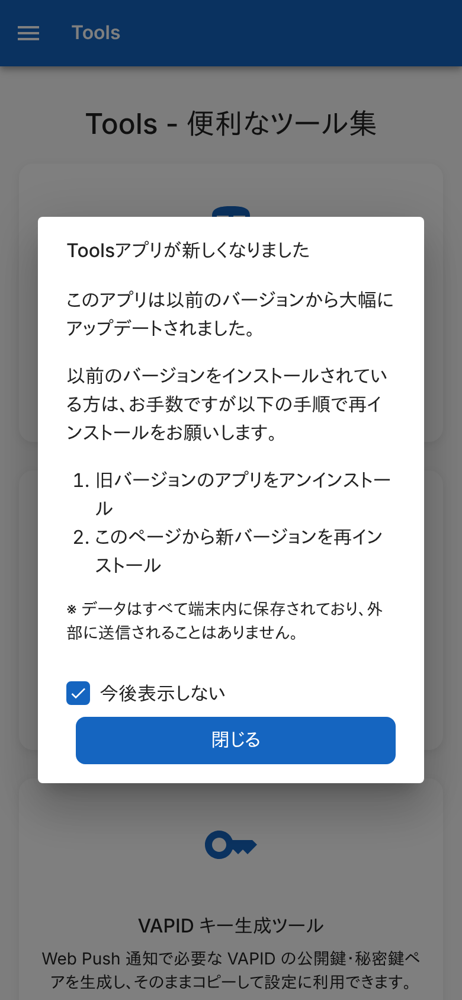
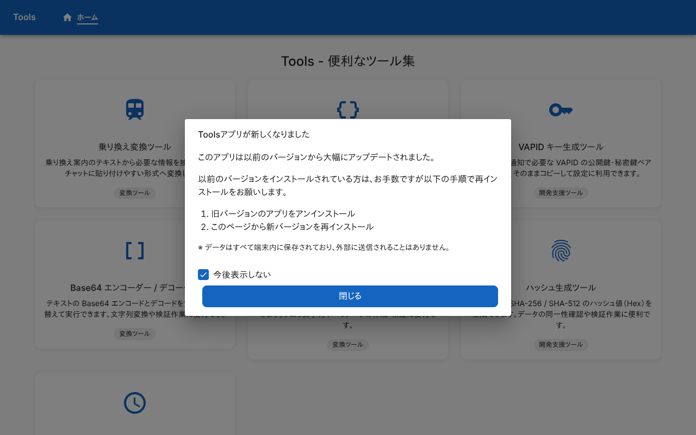
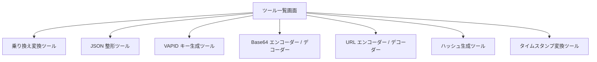

# ツール一覧画面

Tools の入口。7 つのツールをカードで並べ、選んだツールの画面へ移る。ログインは要らない。

## 入口

- パスは `/`
- 各画面のヘッダーのタイトル「Tools」と、ナビゲーションの「ホーム」から来る

## 表示の条件

- 初回の訪問では、[初回訪問ダイアログ](../term/migration-dialog.md)が前面に出る。ダイアログは全画面共通で、閉じるまでこの画面は操作できない

## 表示するもの

| 部分 | 内容 |
|---|---|
| ヘッダー | 全画面共通。タイトル「Tools」 (押すと `/` へ) と、ナビゲーション「ホーム」。スマホ幅ではナビゲーションがメニューボタンに畳まれる |
| 見出し | 「Tools - 便利なツール集」 |
| ツールのカード | 下の表の順に 7 枚。カード全体がリンク。アイコン、名前、説明、カテゴリを出す。PC 幅では 3 列、タブレット幅では 2 列、スマホ幅では 1 列 |
| フッター | 全画面共通。バージョン (環境変数 `APP_VERSION`、なければ `1.0.0`) と、「プライバシーポリシー」「利用規約」(押すとダイアログが開く) |

| 順 | ツール | カテゴリ | 移る先 |
|---|---|---|---|
| 1 | 乗り換え変換ツール | 変換ツール | [`/transit-converter`](./transit-converter.md) |
| 2 | JSON 整形ツール | 変換ツール | [`/json-formatter`](./json-formatter.md) |
| 3 | VAPID キー生成ツール | 開発支援ツール | [`/vapid-generator`](./vapid-generator.md) |
| 4 | Base64 エンコーダー / デコーダー | 変換ツール | [`/base64`](./base64.md) |
| 5 | URL エンコーダー / デコーダー | 変換ツール | [`/url-encoder`](./url-encoder.md) |
| 6 | ハッシュ生成ツール | 開発支援ツール | [`/hash-generator`](./hash-generator.md) |
| 7 | タイムスタンプ変換ツール | 変換ツール | [`/timestamp-converter`](./timestamp-converter.md) |

## 操作

| 操作 | 結果 |
|---|---|
| ツールのカードを押す | そのツールの画面へ移る |
| ヘッダーのタイトル、「ホーム」を押す | `/` へ移る (どの画面からでも) |
| フッターの「プライバシーポリシー」「利用規約」を押す | ダイアログを開く |

API は呼ばない。

## 画面の見た目

### 通常表示

7 つのツールのカード。PC 幅では 3 列に並ぶ。

| スマホ | PC |
|---|---|
|  |  |

### 初回訪問

初めて訪れたとき。[初回訪問ダイアログ](../term/migration-dialog.md)が前面に出る。

| スマホ | PC |
|---|---|
|  |  |

## つながり

