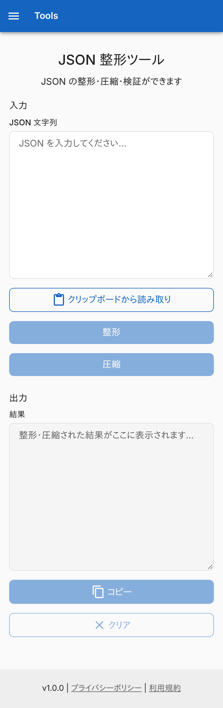
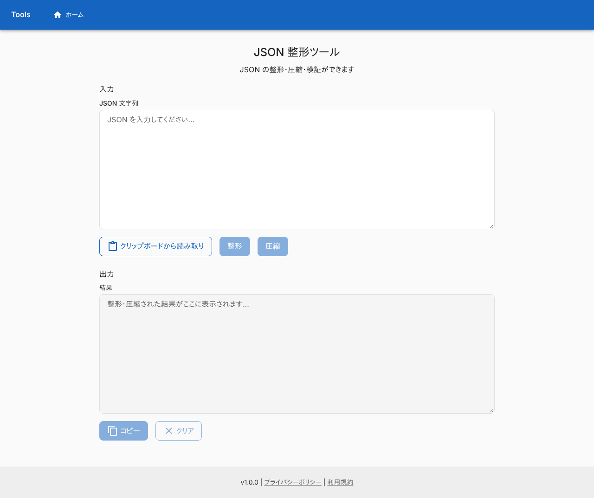
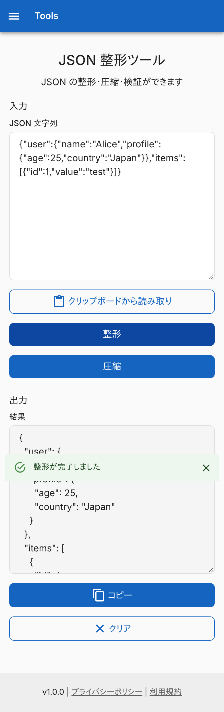
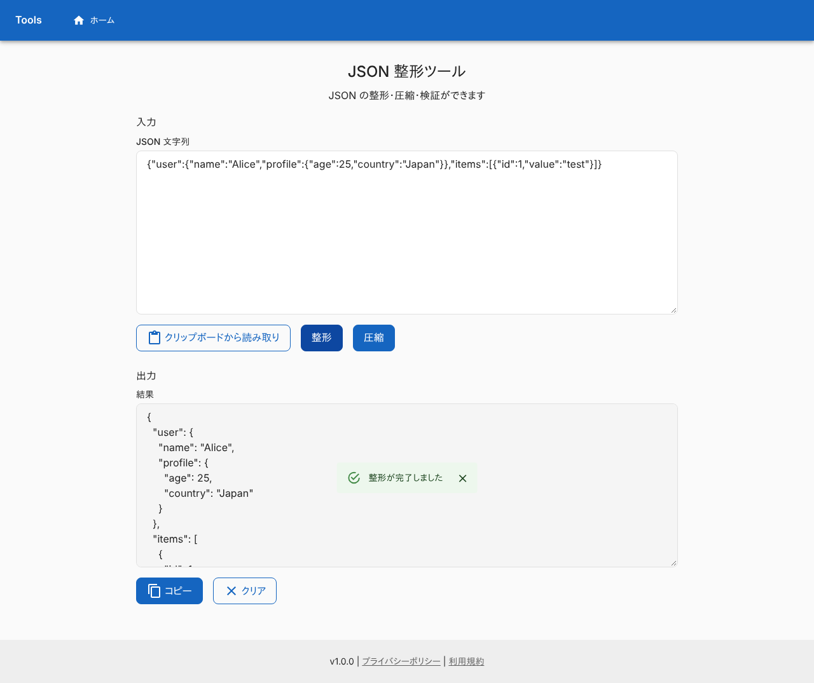
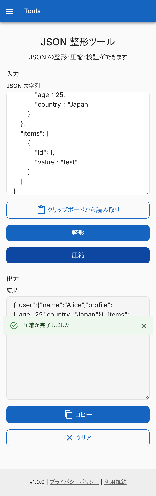
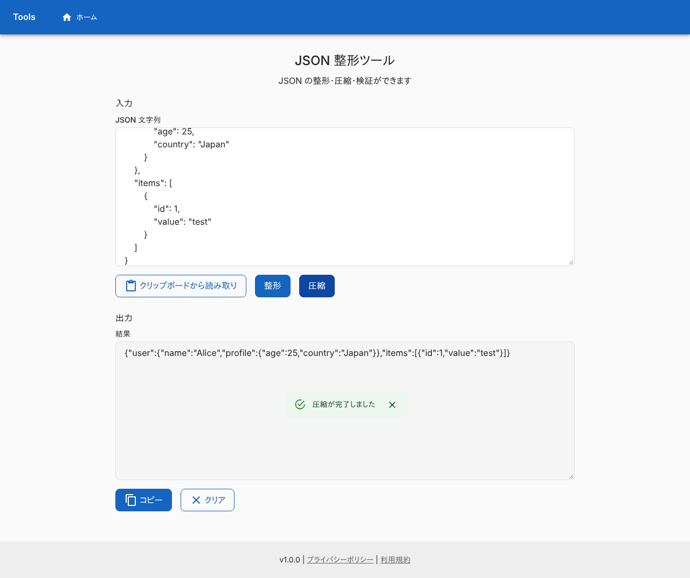
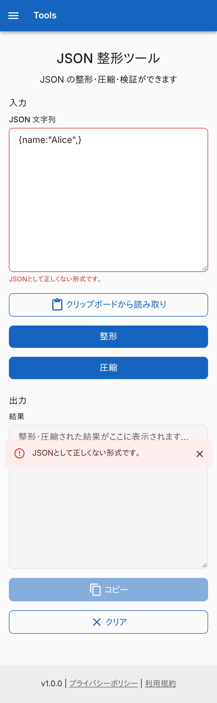
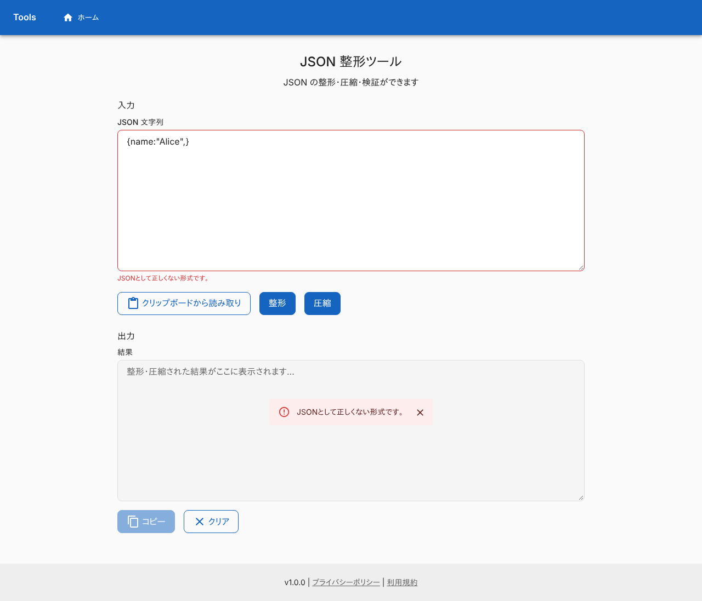
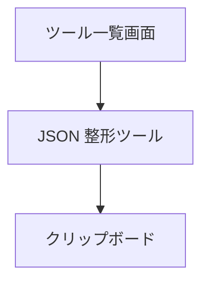

# JSON 整形ツール

JSON の文字列を、読みやすく整形するか、1 行に圧縮する画面。変換はブラウザの中で終わり、入力は外へ送らない。ログインは要らない。

## 入口

- パスは `/json-formatter`
- [ツール一覧画面](./home.md)のカードと、ヘッダーのタイトル・ナビゲーションから来る (ヘッダーは全画面共通)

## 表示の条件

- 初回の訪問では、[初回訪問ダイアログ](../term/migration-dialog.md)が前面に出て、閉じるまでこの画面は操作できない

## 表示するもの

上から次の順に並ぶ。ヘッダーとフッターは全画面共通で、[ツール一覧画面](./home.md)に書いてある。

| 部分 | 内容 |
|---|---|
| 見出し | 「JSON 整形ツール」と、「JSON の整形・圧縮・検証ができます」 |
| 入力 | 複数行 (10 行) の「JSON 文字列」と、「クリップボードから読み取り」「整形」「圧縮」 |
| 出力 | 読み取り専用の複数行 (10 行)「結果」と、「コピー」「クリア」 |

## 状態

- 初めは「整形」「圧縮」「コピー」「クリア」が押せない。「整形」「圧縮」は入力が空白だけのとき、「コピー」は出力が空のとき、「クリア」は入力も出力も空のときに押せない
- JSON として読めない入力は、「JSONとして正しくない形式です。」になる。[通知バー](../term/snackbar.md) (失敗) と、入力欄の赤枠と下の文に出る。出力は前の結果のまま残る。エラーは、次に成功するか、「クリア」か、「クリップボードから読み取り」で消える

## 操作

| 操作 | 結果 |
|---|---|
| 「クリップボードから読み取り」 | [クリップボード操作](../term/clipboard-actions.md)のとおり、入力欄を置き換える |
| 「整形」 | JSON として読み、インデント 2 スペースで整形して出力欄に入れる。「整形が完了しました」(成功) |
| 「圧縮」 | JSON として読み、空白と改行のない 1 行にして出力欄に入れる。「圧縮が完了しました」(成功) |
| 「コピー」 | 出力欄の文字列を[クリップボードへ書く](../term/clipboard-actions.md) |
| 「クリア」 | 入力・出力・エラーを消す |

- 整形も圧縮も、いったん JavaScript の値に読んで書き直す。そのため、キーの並びは JavaScript のオブジェクトの順になり (整数に見えるキーは先頭に出る)、桁の大きい数値は精度が落ちる
- インデント幅の指定、キーの並べ替え、結果の自動コピーはない

API は呼ばない。

## 画面の見た目

### 通常表示

入力前。「整形」「圧縮」は押せない。

| スマホ | PC |
|---|---|
|  |  |

### 整形した

1 行の JSON をインデント 2 スペースで整形した例。

| スマホ | PC |
|---|---|
|  |  |

### 圧縮した

インデントのある JSON を 1 行にした例。

| スマホ | PC |
|---|---|
|  |  |

### JSON として正しくない入力を整形したとき

「JSONとして正しくない形式です。」を出す。

| スマホ | PC |
|---|---|
|  |  |

## つながり

