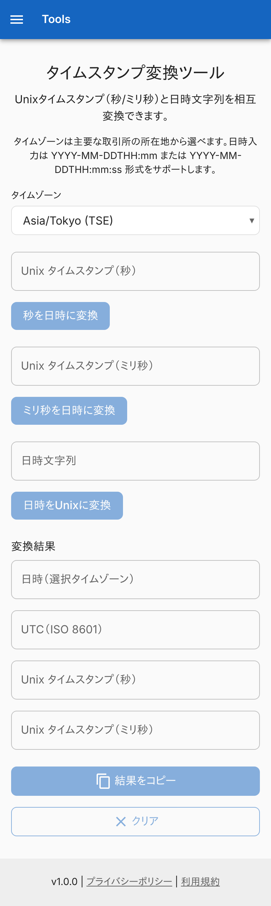
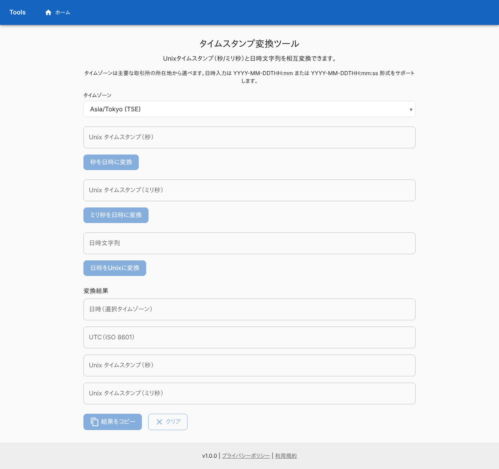
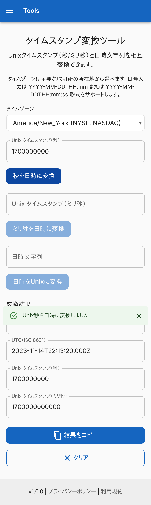
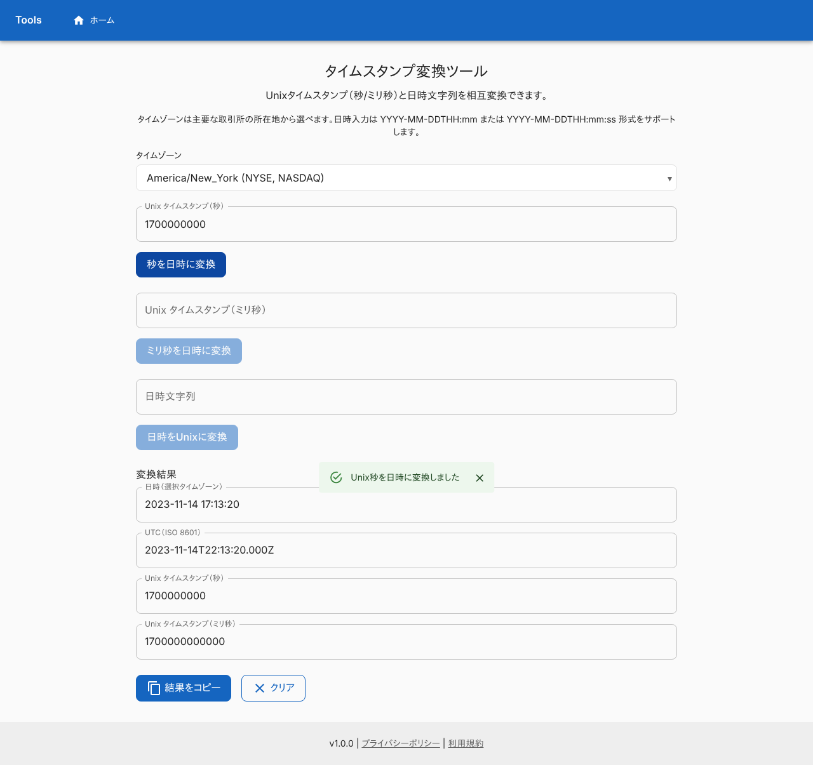
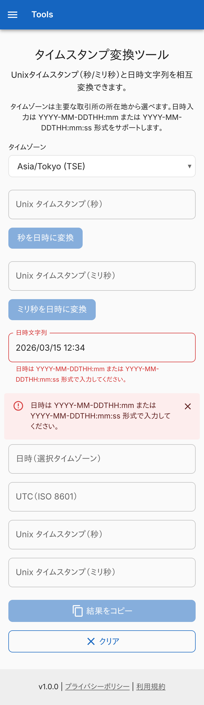
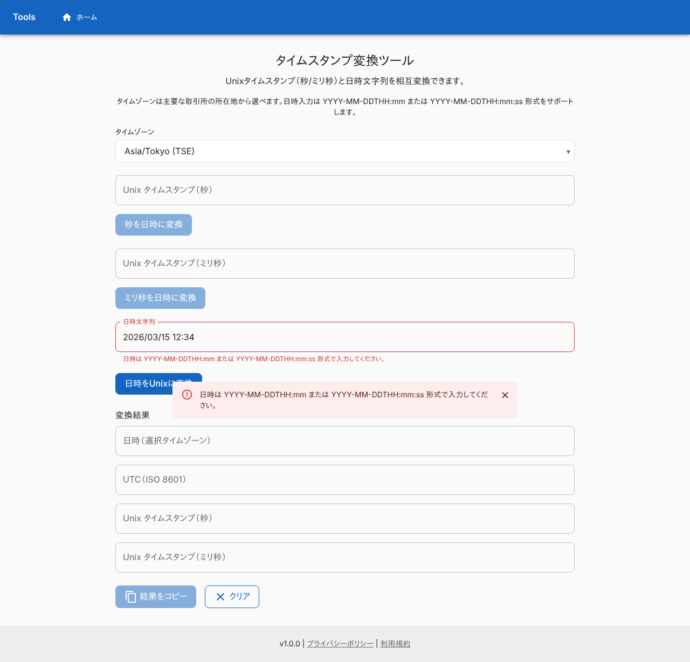
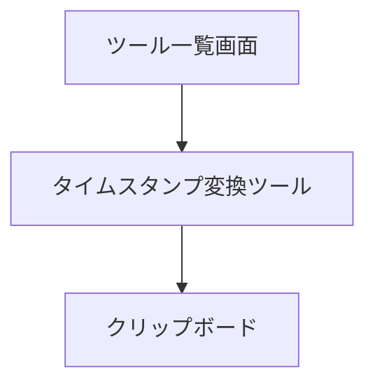

# タイムスタンプ変換ツール

Unix タイムスタンプ (秒・ミリ秒) と日時の文字列を、選んだタイムゾーンで相互に変換する画面。変換はブラウザの中で終わり、入力は外へ送らない。ログインは要らない。

## 入口

- パスは `/timestamp-converter`
- [ツール一覧画面](./home.md)のカードと、ヘッダーのタイトル・ナビゲーションから来る (ヘッダーは全画面共通)

## 表示の条件

- 初回の訪問では、[初回訪問ダイアログ](../term/migration-dialog.md)が前面に出て、閉じるまでこの画面は操作できない

## 表示するもの

上から次の順に並ぶ。ヘッダーとフッターは全画面共通で、[ツール一覧画面](./home.md)に書いてある。

| 部分 | 内容 |
|---|---|
| 見出し | 「タイムスタンプ変換ツール」と、使い方・日時の入力形式の説明 |
| タイムゾーン | 選択欄。初期値は `Asia/Tokyo` |
| Unix 秒 | 入力欄 (例: 1700000000) と「秒を日時に変換」 |
| Unix ミリ秒 | 入力欄 (例: 1700000000000) と「ミリ秒を日時に変換」 |
| 日時文字列 | 入力欄 (例: 2026-03-15T12:34:56) と「日時をUnixに変換」 |
| 変換結果 | 読み取り専用の 4 欄。日時 (選択タイムゾーン)、UTC (ISO 8601)、Unix 秒、Unix ミリ秒 |
| 操作 | 「結果をコピー」「クリア」 |

タイムゾーンの選択肢は、取引所の所在地にあわせた 10 件。

| 値 | 表示 |
|---|---|
| `America/New_York` | NYSE, NASDAQ |
| `America/Chicago` | CME |
| `Europe/London` | LSE |
| `Europe/Paris` | Euronext |
| `Europe/Berlin` | FWB |
| `Asia/Tokyo` | TSE |
| `Asia/Hong_Kong` | HKEX |
| `Asia/Shanghai` | SSE |
| `Asia/Singapore` | SGX |
| `Australia/Sydney` | ASX |

## 状態

- 初めは 3 つの変換のボタンと「結果をコピー」が押せない。変換のボタンは、その欄が空白だけのときに押せない。「結果をコピー」は結果がないときに、「クリア」は入力も結果もないときに押せない
- 結果欄は、3 つの入力のどれを変換しても同じ 4 欄が埋まる。入力欄どうしは連動しない
- 変換に失敗すると、変換した欄の下に赤い文を出し、[通知バー](../term/snackbar.md) (失敗) にも出す。ほかの入力欄と結果欄は変わらない。エラーは、次に変換に成功するか、「クリア」で消える

| 変換 | 入力の条件 | メッセージ |
|---|---|---|
| 秒・ミリ秒 | 整数 (先頭の `-` は可)。小数、`+`、空白や文字の混じりは不可。JavaScript で正確に扱える整数の範囲で、日時として表せること | Unixタイムスタンプは整数で入力してください。 |
| 日時 | `YYYY-MM-DDTHH:mm` か `YYYY-MM-DDTHH:mm:ss` (年は 4 桁、`T` で区切る)。実在する日時で、選んだタイムゾーンに存在する時刻 (夏時間で飛ぶ時刻は不可) | 日時は YYYY-MM-DDTHH:mm または YYYY-MM-DDTHH:mm:ss 形式で入力してください。 |

## 変換のしかた

- 結果の日時は `YYYY-MM-DD HH:mm:ss` (24 時間表記、秒まで)。UTC は ISO 8601 (`...Z`、ミリ秒つき)
- 秒を入力したときは、1,000 倍したミリ秒として扱う。結果の Unix 秒は、ミリ秒を 1,000 で割って切り捨てた値で、ミリ秒の端数は日時の表示に出ない
- 日時を入力したときは、選んだタイムゾーンの時刻として読む。夏時間の切り替えで時刻が重なる場合は、タイムゾーンのオフセットを再計算して決める
- タイムゾーンを切り替えても、すでにある結果は作り直さない。次の変換から切り替え後のタイムゾーンを使う

## 操作

| 操作 | 結果 |
|---|---|
| タイムゾーンを選ぶ | 選択を切り替える。何も変換しない |
| 「秒を日時に変換」 | Unix 秒を読み、結果欄を埋める。「Unix秒を日時に変換しました」(成功) |
| 「ミリ秒を日時に変換」 | Unix ミリ秒を読み、結果欄を埋める。「Unixミリ秒を日時に変換しました」(成功) |
| 「日時をUnixに変換」 | 日時を読み、結果欄を埋める。「日時をUnixタイムスタンプに変換しました」(成功) |
| 「結果をコピー」 | 結果を 5 行のテキストにして[クリップボードへ書く](../term/clipboard-actions.md) |
| 「クリア」 | 3 つの入力・結果・エラーを消す。タイムゾーンは変えない |

API は呼ばない。

## 画面の見た目

### 通常表示

入力前。タイムゾーンは `Asia/Tokyo`。

| スマホ | PC |
|---|---|
|  |  |

### Unix 秒を日時に変換した

タイムゾーンを `America/New_York` にした例。結果欄の 4 つが埋まる。

| スマホ | PC |
|---|---|
|  |  |

### 日時の形式が違うとき

`2026/03/15 12:34` を入れた例。日時の欄の下に形式の説明を出す。

| スマホ | PC |
|---|---|
|  |  |

## つながり

