# 乗り換え変換ツール

乗り換え案内アプリで共有したテキストを貼り付け、必要な項目だけを選んで、メモやチャットに貼りやすい形に整える画面。変換はブラウザの中で終わり、入力は外へ送らない。ログインは要らない。

## 入口

- パスは `/transit-converter`
- [ツール一覧画面](./home.md)のカードと、ヘッダーのタイトル・ナビゲーションから来る (ヘッダーは全画面共通)
- 他のアプリの共有シートから来ると、共有された内容が入力欄に入った状態で開く ([共有シートからの取り込み](../flow/share-target.md))

## 表示の条件

- 初回の訪問では、[初回訪問ダイアログ](../term/migration-dialog.md)が前面に出て、閉じるまでこの画面は操作できない

## 表示するもの

上から次の順に並ぶ。ヘッダーとフッターは全画面共通で、[ツール一覧画面](./home.md)に書いてある。

| 部分 | 内容 |
|---|---|
| 見出し | 「乗り換え変換ツール」と、使い方の説明 |
| 表示設定 | 折りたたみ式で、初めは閉じている。出力に含める項目のチェックボックス |
| 入力 | 複数行 (10 行) の「乗り換え案内テキスト」と、「クリップボードから読み取り」「変換」 |
| 出力 | 読み取り専用の複数行 (10 行)「変換結果」と、「コピー」「クリア」 |

表示設定の項目。

| 項目 | 初期値 |
|---|---|
| 日付を表示 | ON |
| 出発地・到着地を表示 | ON |
| 出発時刻・到着時刻を表示 | ON |
| 所要時間を表示 | ON |
| 運賃を表示 | ON |
| 乗換回数を表示 | ON |
| 距離を表示 | OFF |
| ルート詳細を表示 | ON |
| 時刻範囲を表示 (ルート詳細の中) | ON |
| 路線名を表示 (ルート詳細の中) | ON |
| 番線情報を表示 (ルート詳細の中) | OFF |

- 「ルート詳細を表示」を OFF にすると、中の 3 項目も OFF になり、操作できなくなる。中の 3 項目のどれかを ON にすると、「ルート詳細を表示」も ON になる
- 設定を変えるたびに、ブラウザの `localStorage` (キーは `transit-converter-display-settings`) に保存する。次に開いたときは、保存した値を初期値に重ねて復元する。読み書きに失敗しても、初期値のまま使える
- 変換済みのときに設定を変えると、出力をその場で作り直す (入力の解析はやり直さない)

## 状態

- 初めは「変換」「コピー」「クリア」が押せない。「変換」は入力が空白だけのとき、「コピー」は出力が空のとき、「クリア」は入力も出力も空のときに押せない
- 「変換」を押すと、次の順に確かめる。最初に外れた条件のメッセージを出す

| 順 | 条件 | メッセージ |
|---|---|---|
| 1 | 入力が空白だけでない | 入力が空です。乗り換え案内のテキストを貼り付けてください。 (「変換」が押せないため、画面からは出ない) |
| 2 | 「⇒」を含む | 乗り換え案内のテキストを正しく解析できませんでした。 |
| 3 | 解析できる (下) | テキストを解析できませんでした。乗り換え案内のテキストを確認してください。 |

- 解析できる条件は、改行で分けた行の 1 行目が `出発地 ⇒ 到着地`、3 行目が `H:MM ⇒ H:MM` の形であること。行の前後の空白は無視する。2 行目は日付として、そのまま使う
- 予期しない例外のときは「予期しないエラーが発生しました。」を出す
- エラーは、[通知バー](../term/snackbar.md) (失敗) と、入力欄の赤枠と下の文に出る。出力は前の結果のまま残る。エラーは、次に変換に成功するか、「クリア」か、「クリップボードから読み取り」で消える
- 成功すると、「変換が完了しました」(成功) を出す

## 解析する項目

| 項目 | 読み取る行 |
|---|---|
| 出発地・到着地、日付、出発時刻・到着時刻 | 1〜3 行目 |
| 所要時間 | `所要時間 {値}` |
| 運賃 | `運賃[...] {値}` |
| 乗換回数 | `乗換 {N}回` |
| 距離 | `距離 {N} km` (数字と小数点) |
| ルート | 「■」で始まる行を駅として、次の行から続く、時刻範囲 (`↓ 10:00〜10:20`)、路線 (`↓` で始まり「行」か「方面」を含む行)、番線 (`↓` で始まり「番線」を含む行) を、その駅にひもづける |

## 出力の形

設定がすべて ON のときの形。

```
【乗り換え案内】{日付}
{出発地} {出発時刻} → {到着地} {到着時刻}
所要時間: ... / 運賃: ... / 乗換: N回 / 距離: ...

[ルート]
■ {駅} ({時刻範囲})
→ {路線} [{番線}]
■ {終点の駅}
```

- 設定が OFF の項目は出さない。出す項目が 1 つもない行は、行ごと出さない
- 出発地・到着地を OFF にすると、出発時刻・到着時刻も出ない
- 所要時間・運賃・乗換回数・距離は、入力に見つかったものだけを ` / ` でつなぐ
- ルートの路線と番線は、最後の駅の次には出さない。番線は路線の行の末尾に付くため、路線名を OFF にすると番線も出ない

## 操作

| 操作 | 結果 |
|---|---|
| 表示設定の項目を切り替える | 保存し、変換済みなら出力を作り直す |
| 「クリップボードから読み取り」 | [クリップボード操作](../term/clipboard-actions.md)のとおり、入力欄を置き換える |
| 「変換」 | 上の順に確かめ、解析して出力欄に整形結果を入れる |
| 「コピー」 | 出力欄の文字列を[クリップボードへ書く](../term/clipboard-actions.md) |
| 「クリア」 | 入力・出力・エラーを消す。表示設定は変えない |

API は呼ばない。

## 共有されたデータ

- URL に `url` か `text` があるとき、入力欄に入れる (`url` を優先)。アドレスを `/transit-converter` に置き換え、「共有されたデータを読み込みました」(案内) を出す。自動では変換しない
- 詳しい経路は [共有シートからの取り込み](../flow/share-target.md)

## 画面の見た目

### 通常表示

入力前。表示設定は閉じている。

| スマホ | PC |
|---|---|
| 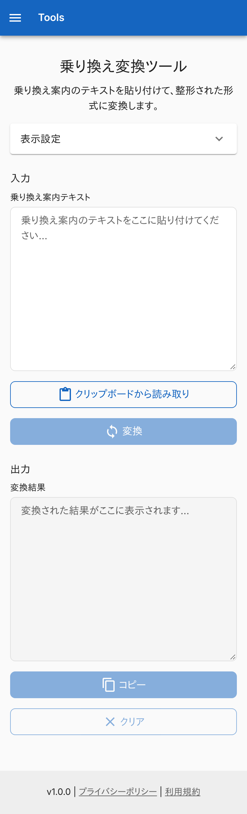 | 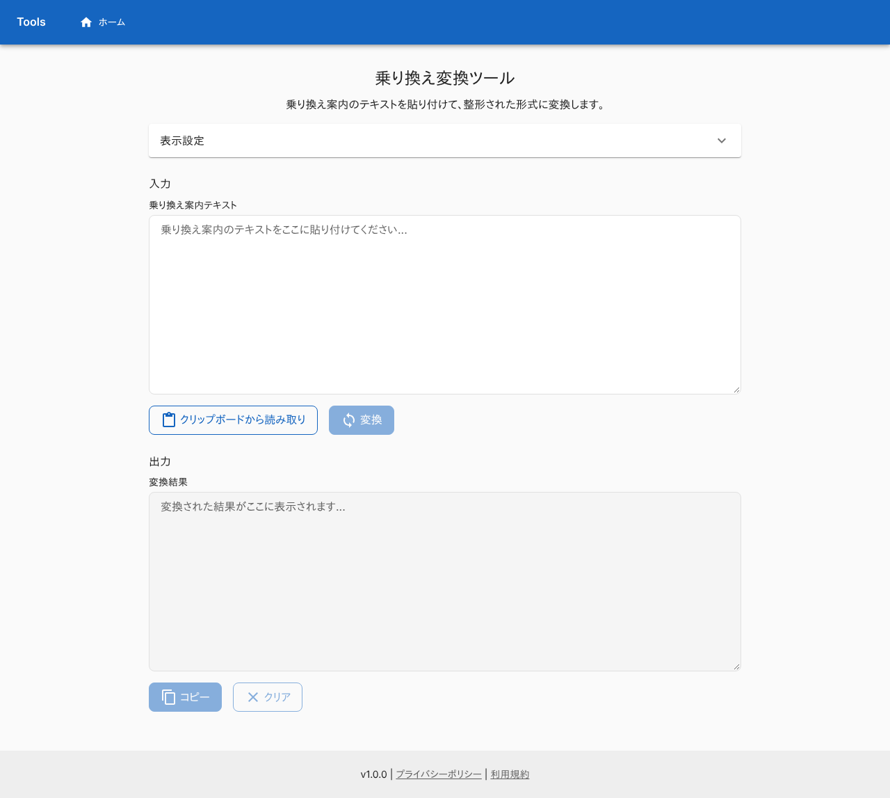 |

### 変換した

初期の表示設定で変換した結果。

| スマホ | PC |
|---|---|
| 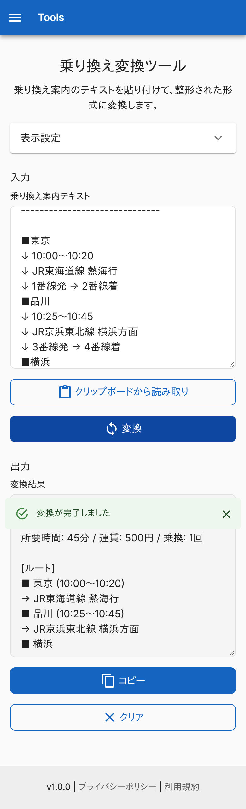 | 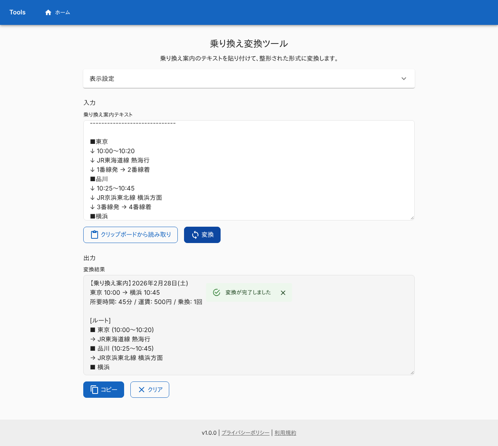 |

### 表示設定を開いた状態

距離と番線情報を ON にした例。出力に反映される。

| スマホ | PC |
|---|---|
| 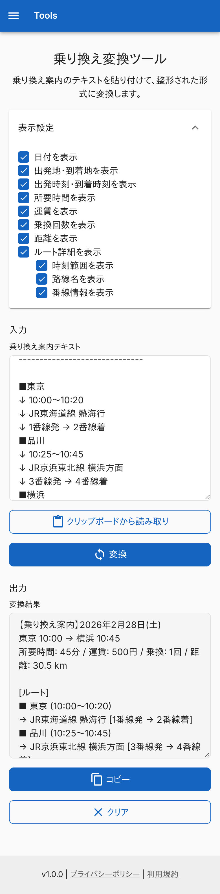 | 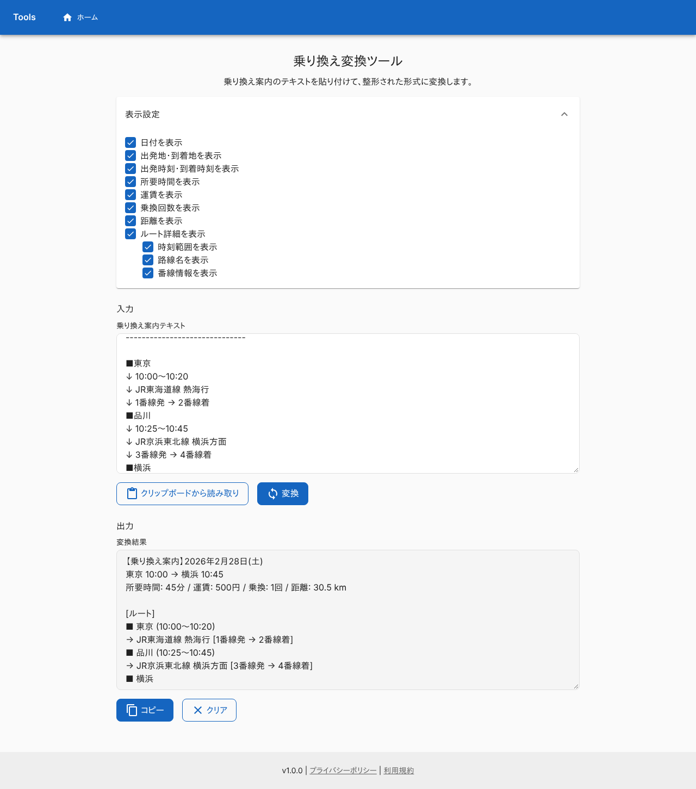 |

### 乗り換え案内でないテキストを変換したとき

「乗り換え案内のテキストを正しく解析できませんでした。」を出す。

| スマホ | PC |
|---|---|
| 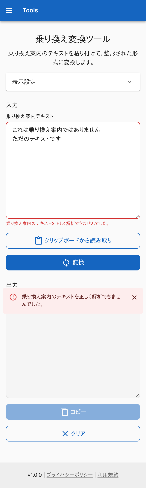 | 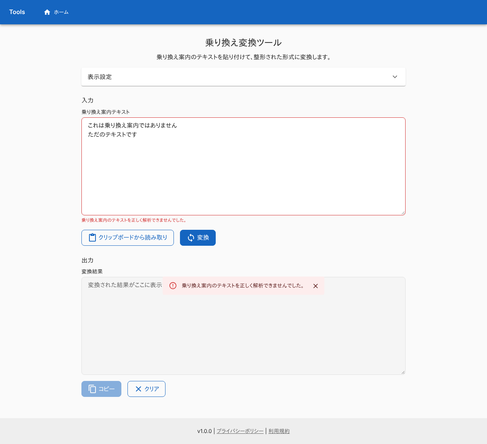 |

### 共有されたとき

共有されたテキストが入力欄に入り、「共有されたデータを読み込みました」を出す。変換はまだしていない。

| スマホ | PC |
|---|---|
| 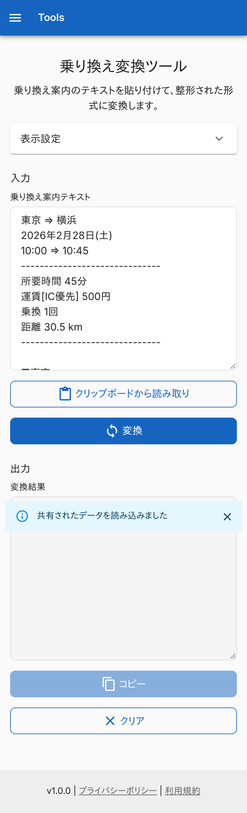 | 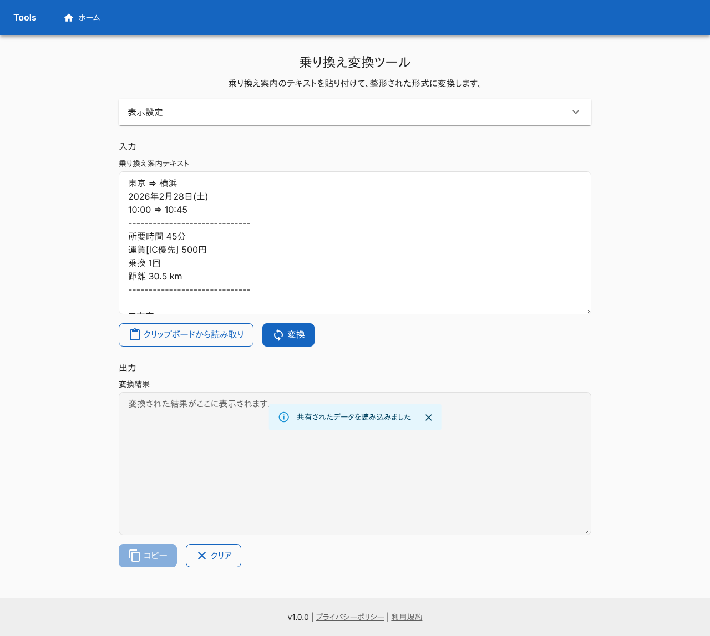 |

## つながり

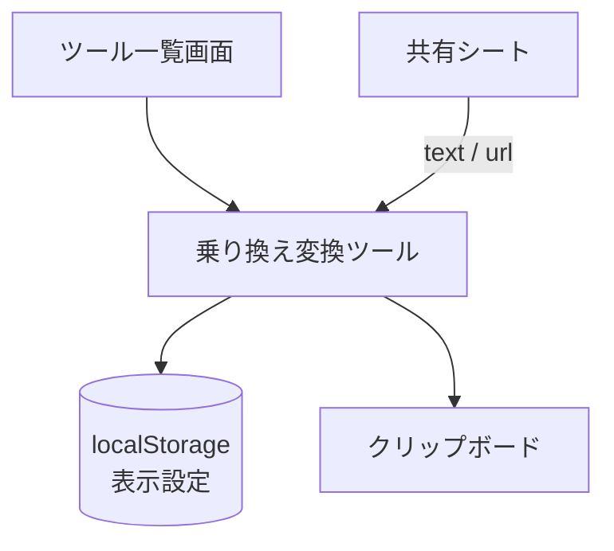
