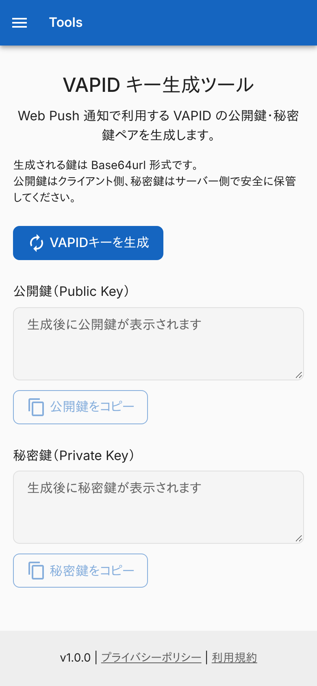
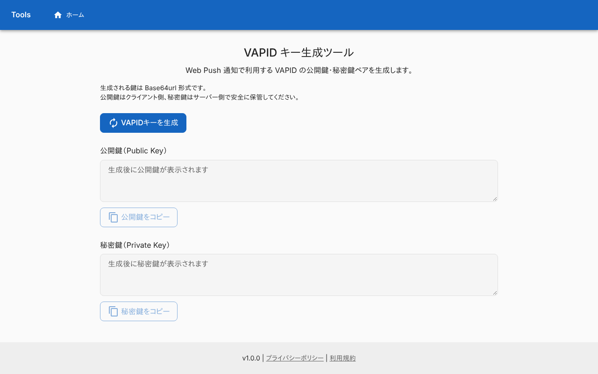
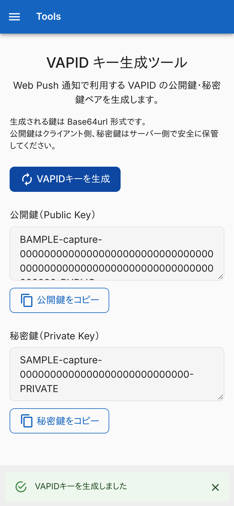
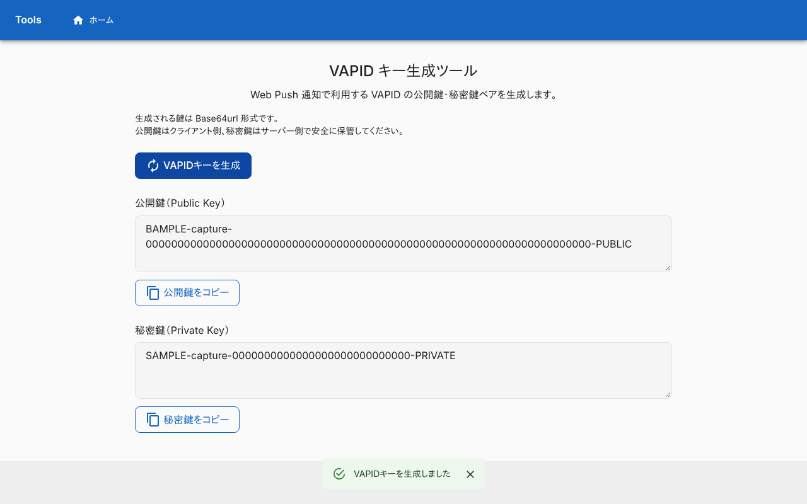
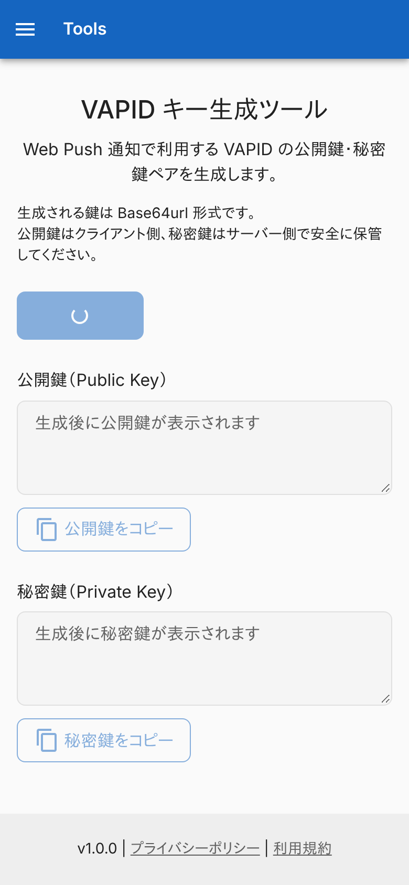
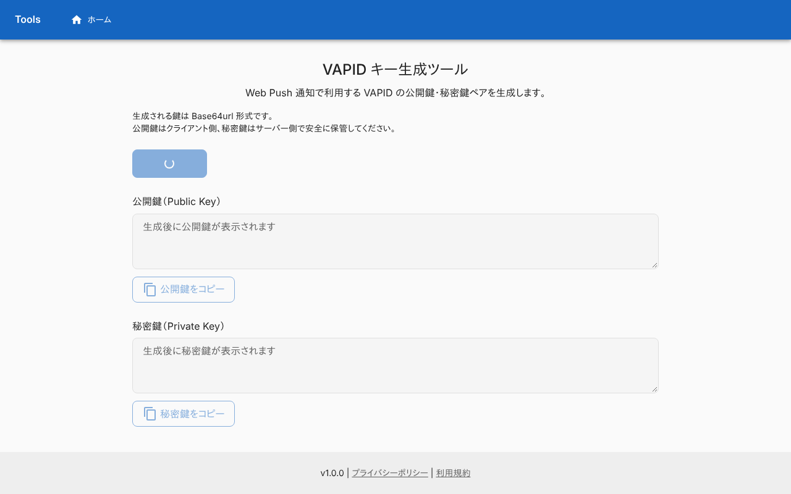
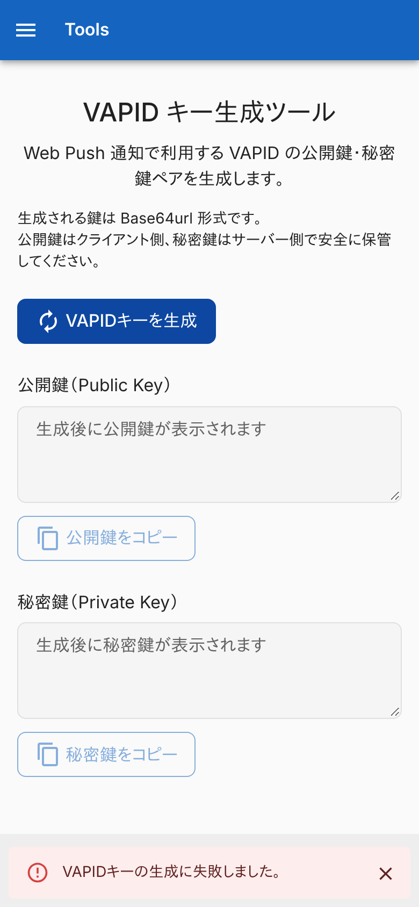
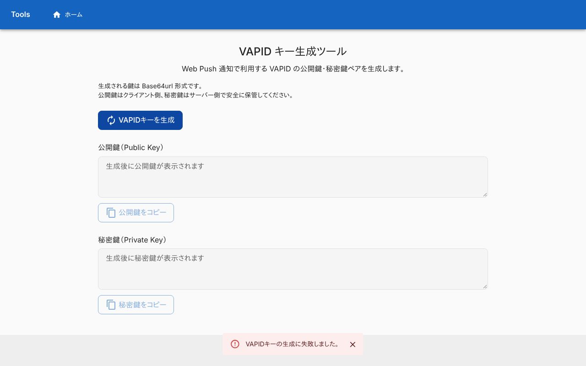
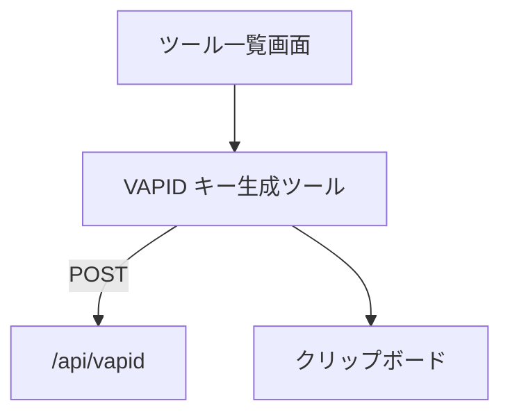

# VAPID キー生成ツール

Web Push 通知に使う[VAPID キー](../term/vapid-key.md)のペアを作り、コピーする画面。Tools で唯一、サーバーの API を呼ぶ。ログインは要らない。

## 入口

- パスは `/vapid-generator`
- [ツール一覧画面](./home.md)のカードと、ヘッダーのタイトル・ナビゲーションから来る (ヘッダーは全画面共通)

## 表示の条件

- 初回の訪問では、[初回訪問ダイアログ](../term/migration-dialog.md)が前面に出て、閉じるまでこの画面は操作できない

## 表示するもの

上から次の順に並ぶ。ヘッダーとフッターは全画面共通で、[ツール一覧画面](./home.md)に書いてある。

| 部分 | 内容 |
|---|---|
| 見出し | 「VAPID キー生成ツール」と、使い方の説明 |
| 注意書き | 鍵は Base64url 形式であること。公開鍵はクライアント側、秘密鍵はサーバー側で安全に保管すること |
| 生成 | 「VAPIDキーを生成」ボタン |
| 公開鍵 (Public Key) | 読み取り専用の複数行 (3 行)。鍵がないときは「生成後に公開鍵が表示されます」。「公開鍵をコピー」 |
| 秘密鍵 (Private Key) | 読み取り専用の複数行 (3 行)。鍵がないときは「生成後に秘密鍵が表示されます」。「秘密鍵をコピー」 |

## 状態

- 初めは鍵がなく、2 つのコピーのボタンが押せない
- 生成中は、「VAPIDキーを生成」がスピナーになり、押せない
- 失敗したときの扱いは、[通知バー](../term/snackbar.md) (失敗) にメッセージを出すだけで、すでに表示している鍵はそのまま残る

| 条件 | メッセージ |
|---|---|
| 通信に失敗した、または API が 200 台以外を返した | VAPIDキーの生成に失敗しました。 |
| API の応答に、文字列の `publicKey` と `privateKey` がない | VAPIDキー生成APIのレスポンス形式が不正です。 |

## 操作

| 操作 | 結果 |
|---|---|
| 「VAPIDキーを生成」 | [VAPID キー API](../api/vapid.md)の `POST /api/vapid` を呼び、返った鍵で 2 つの欄を置き換える。「VAPIDキーを生成しました」(成功)。もう一度押すと、新しい鍵になる |
| 「公開鍵をコピー」「秘密鍵をコピー」 | その鍵を[クリップボードへ書く](../term/clipboard-actions.md) |

鍵は画面の中だけにあり、ブラウザには保存しない。

## 画面の見た目

### 通常表示

鍵はまだない。コピーのボタンは押せない。

| スマホ | PC |
|---|---|
|  |  |

### 生成した

「VAPIDキーを生成しました」を出す。鍵は撮影用の見本で、実在しない値。

| スマホ | PC |
|---|---|
|  |  |

### 生成中

ボタンがスピナーになり、押せない。API の応答が返らない例。

| スマホ | PC |
|---|---|
|  |  |

### 生成に失敗したとき

API が 500 を返した例。「VAPIDキーの生成に失敗しました。」を出す。

| スマホ | PC |
|---|---|
|  |  |

## つながり

