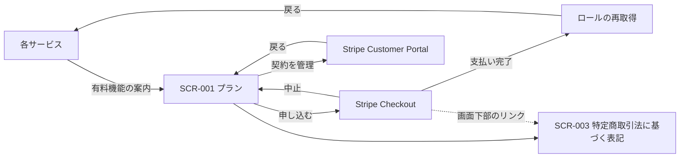
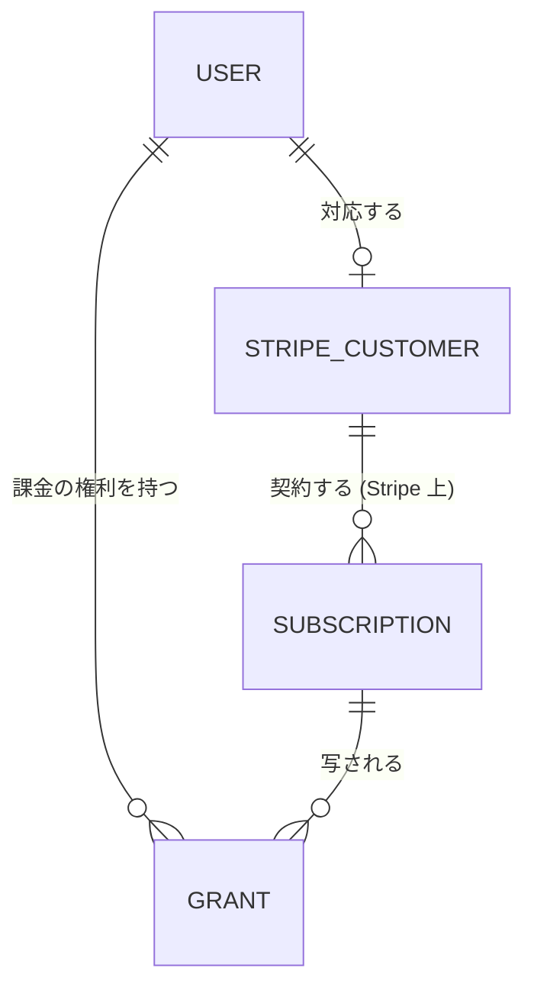

<!--
    このドキュメントは開発時のみ使用します。
    開発完了後に docs/services/auth/ と docs/development/shared-ui-components.md に統合して削除します。
-->

# サブスクリプション課金の土台 外部設計書

## 1. 画面設計

### 1.1 画面一覧

| 画面 ID | 画面名 | サービス | 対応ユースケース | Phase | 優先度 |
|--------|--------|---------|--------------|-------|-------|
| SCR-001 | プラン | auth | UC-001, UC-002, UC-005 | P2 / P3 | 高 |
| SCR-002 | ユーザー編集 (課金の権利) | auth | UC-004 | P1 | 高 |
| SCR-003 | 特定商取引法に基づく表記 | auth | UC-005 | P3 | 高 |
| - | Stripe の決済画面 (Checkout) | Stripe | UC-001 | P2 | - |
| - | Stripe の Customer Portal | Stripe | UC-002 | P2 | - |

パスは各 Phase で決める。

### 1.2 画面遷移図

- 「ロールの再取得」には、auth の既存の `/refresh` (ロールを強制的に読み直してから戻り先へ送る画面) を使う。

### 1.3 主要画面の設計

#### SCR-001: プラン (auth)

**概要**

料金を示し、ログイン中の利用者が自分の契約の状態を確かめ、申し込みと契約の管理へ進む画面。料金の表示はログインせずに見られる。

**表示内容**

- 誰でも: プランの内容と価格 (税込)、更新の周期、解約の方法 (Customer Portal から期間の終わりまでに解約する)
- 契約がないとき: 申し込みの操作 (未ログインならログインへ案内する)
- 契約中のとき: プラン名、次の更新日 (解約予約中なら終了日)、契約の管理の操作
- 手動で付いた課金の権利があるとき: その有効期限 (Stripe の契約とは別に表示する)

**判断根拠**

- auth に置く。申し込みには自サービスのユーザーと Stripe の顧客を結びつける処理が要り、ユーザーを持つのは auth だけだから。
- 料金を別の画面にせず、この画面で兼ねる。料金を見る画面と申し込む画面が分かれると、価格の表記が 2 か所になって食い違いやすい。
- 解約・支払い方法の変更・請求の履歴は自作せず、Stripe の Customer Portal に任せる。作る量を減らし、カード情報を自サービスで扱わないため。

#### SCR-002: ユーザー編集 (課金の権利) (auth 管理画面)

**概要**

既存のユーザー編集画面に、課金の権利の欄を足す。

**表示内容**

- 課金の権利の一覧: ロール、出どころ、有効期限、状態 (有効 / 期限切れ / 取り消し)
- 手動の権利の追加: ロールと有効期限を指定する
- 手動の権利の期限延長・取り消し
- Stripe 由来の権利は表示のみとし、ここでは変更できない (Stripe 上の契約と食い違わないようにするため)

**判断根拠**

- 手動ロールの編集と並べて置き、「このユーザーの有効なロールがなぜそうなっているか」を 1 画面で読めるようにする。

#### SCR-003: 特定商取引法に基づく表記 (auth)

**概要**

ログインせずに見られる公開ページ。表記の中身 (事業者の情報、支払い・提供・解約・返金の条件) は `libs/ui` の共通部品にし、auth のページはそれを表示する。

**載せるもの**

- 氏名・住所・電話番号: 「請求があれば遅滞なく開示いたします」とする
- 連絡先のメールアドレス
- 定期課金であること、価格 (税込)、支払いの時期と方法、提供の時期
- 解約の方法と条件、返金の扱い

**判断根拠**

- portal には置かない。portal は技術記事のブログで、サービスの料金や販売の情報を置くと宣伝サイトになってしまう。
- 法的な公開情報は、サービスごとに置き、中身を共通部品にする。既存のプライバシーポリシーと利用規約と同じ作り (共通のデータと表示部品を `libs/ui` に持ち、各サービスが使う)。課金を受けるサービスが増えても、表記が食い違わない。
- 今回は申し込みの入口がある auth に置く。Stripe の本番審査では、このページの URL を登録する。
- 定期課金では、申し込みの最終確認の段階で、金額・更新の周期・解約の方法が分かる必要がある (2022 年の特定商取引法の改正)。金額と周期は Stripe の決済画面が出す。解約の方法は SCR-001 とこの表記で補う。

### 1.4 レスポンシブ方針

既存の auth の方針に従う。

### 1.5 アクセシビリティ方針

既存の auth の方針に従う。

---

## 2. 概念データモデル

### 2.1 主要エンティティ一覧

| エンティティ | 説明 |
|-------------|------|
| 利用者 | 既存のユーザー。手動ロールを持つ |
| 課金の権利 | 利用者に付く有料ロール。出どころ・有効期限・状態を持つ |
| Stripe の顧客の対応 | 利用者と Stripe の顧客の 1 対 1 の対応 |

### 2.2 エンティティ関係図

- 有効なロール = 利用者の手動ロール ∪ 期限内で取り消されていない課金の権利のロール

---

## 3. 設計上の決定事項 (ADR)

### ADR-001: 課金を「ロールの入口の一つ」として扱う

- **決定**: 課金の状態を、各サービスに直接見せない。課金の権利としてロールに変換し、既存のロール認可に載せる。
- **理由**: 各サービスはすでにロールから導かれる権限で認可している。課金専用の判定を各サービスに持たせると、サービスごとに Stripe の状態の解釈がばらつく。
- **結果**: 各サービスは、有料ロールの権限を確かめるだけで出し分けを作れる。

### ADR-002: 課金の権利を手動ロールと分けて持つ

- **決定**: 課金で付くロールは、手動ロールとは別に、出どころと有効期限つきで持つ。
- **理由**: 同じロールの一覧に混ぜると、解約や期限切れで外すときに、運営者が手で付けたロールまで外しかねない。期限を持たせると、手動の付与でも外し忘れが起きない。

### ADR-003: Stripe を主軸にし、販売代行型は使わない

- **決定**: Stripe (Billing + Customer Portal + 通知) を使う。販売代行型 (Stripe Managed Payments・Paddle など) は使わない。
- **理由**: 当面は国内の顧客が中心で、消費税は免税事業者の範囲に収まる。販売代行型の追加手数料 (Stripe Managed Payments で +3.5%) に見合う利点がない。日本の売り手の国内取引は、Stripe Managed Payments の税務代行の対象外でもある。
- **見直す条件**: 海外の顧客が増え、海外の税の処理が必要になったとき。

### ADR-004: 課金の公開情報はサービスごとに置き、中身を共通部品にする

- **決定**: 料金と特定商取引法に基づく表記は、課金を受けるサービスに置く。表記の中身は `libs/ui` の共通部品にする。portal には置かない。
- **理由**: portal は技術記事のブログで、サービスの宣伝の場ではない。プライバシーポリシーと利用規約も、共通のデータと部品を各サービスが使う作りになっており、それに揃える。
